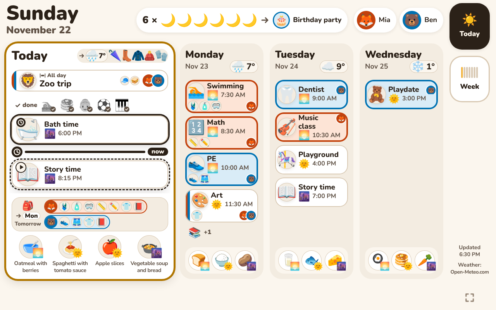
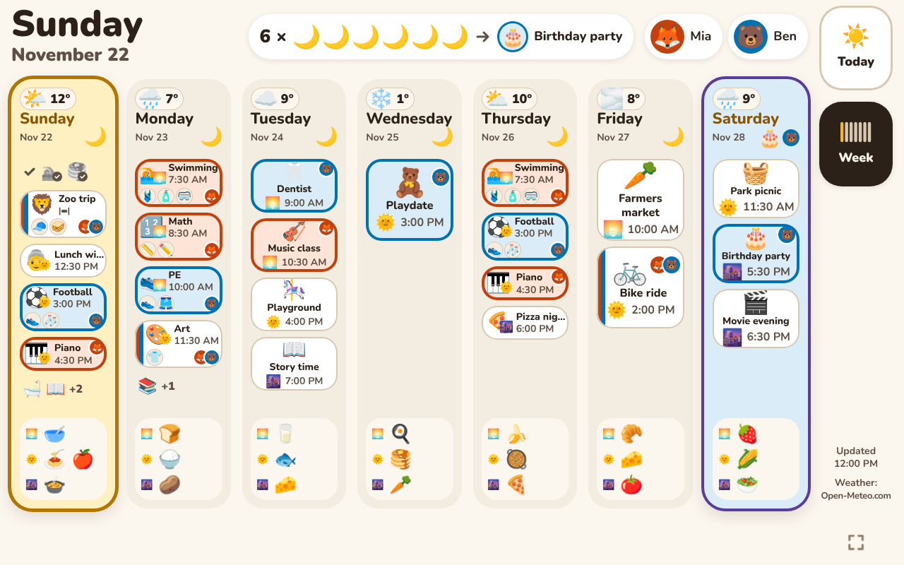
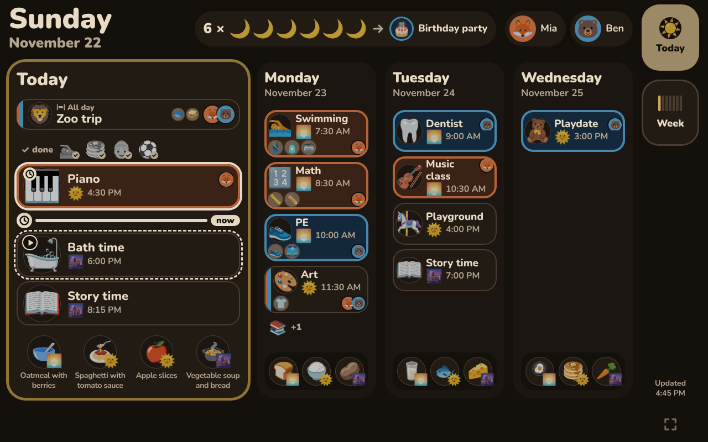
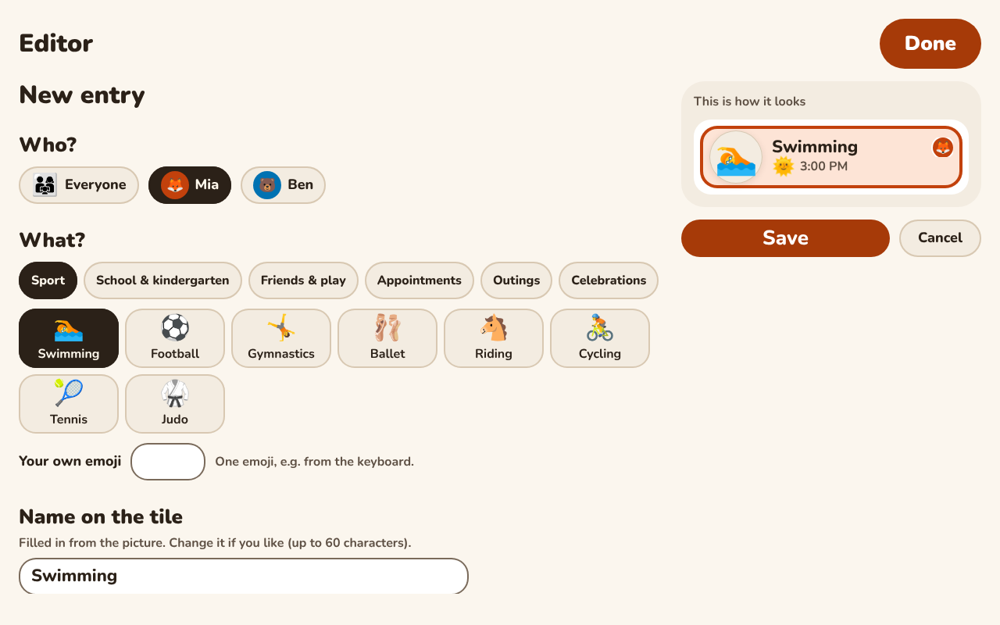
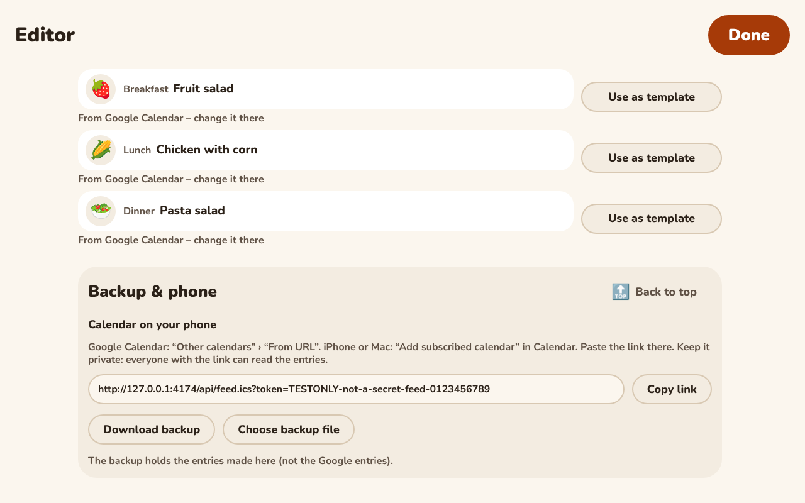
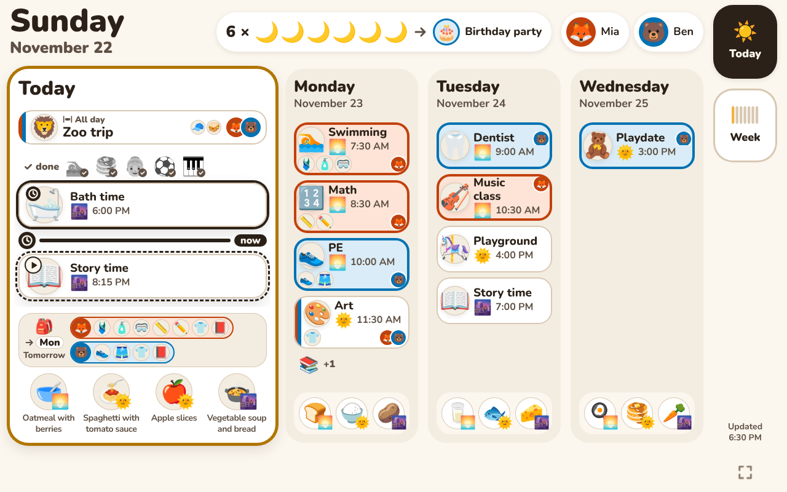
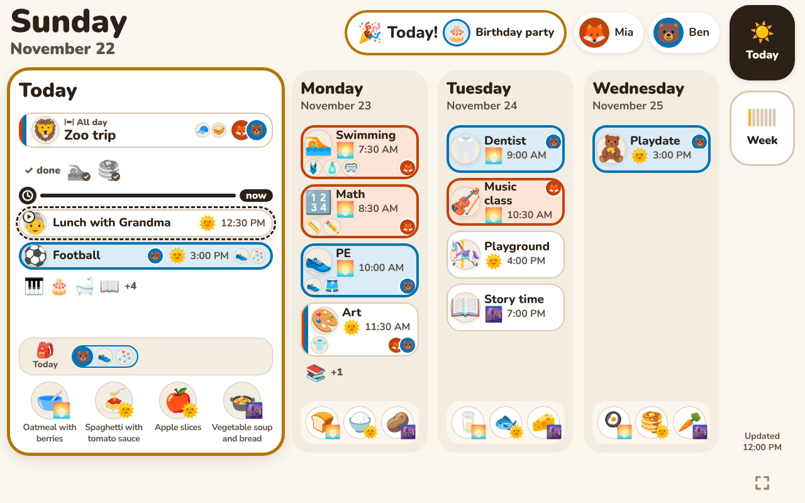

# KidBoard

[English](README.md) | [Deutsch](README.de.md)

Ein quelloffener, icon-basierter Familienkalender und Speiseplan für ein Wand-Tablet im
Kiosk-Modus. Gedacht für Kinder (etwa 3-8 Jahre), die noch nicht lesen können: große Bilder
statt Text, damit sie selbst sehen, was heute ansteht, was in den Rucksack muss und was sie
anziehen sollen.

Eltern tragen Termine **direkt in der App** ein, auf dem Tablet oder dem Handy, geschützt
durch eine PIN: Kind wählen, Bild wählen, einmalig oder jede Woche, fertig. KidBoard
speichert sie in deinem eigenen Cloudflare-Konto, mehr ist nicht einzurichten. Ihr plant
schon im Google Kalender? Diese Kalender kann KidBoard zusätzlich anzeigen, als Option.



## Was KidBoard kann

- **Heute und die nächsten Tage:** Heute ist eine große Karte (ganztägige Termine als
  Banner, ein "vorbei"-Streifen, eine "jetzt"-Linie, der nächste Termin hervorgehoben),
  danach die nächsten drei Tage. Die Wochenansicht zeigt sieben Tage auf einen Blick, mit
  Mahlzeiten in jeder Spalte.
- **Eltern-Editor:** Termine auf dem Tablet anlegen und ändern: wer, was (über 40
  Aktivitäts-Bilder in sechs Gruppen oder ein eigenes Emoji), wann, einmalig oder wöchentlich
  (jede Woche oder alle zwei Wochen), was mit muss, "Nächte zählen". Eine Vorschau zeigt die
  Kachel schon vor dem Speichern. "Nochmal"-Vorschläge und Schnellvorlagen machen
  Wiederkehrendes zu zwei Fingertipps.
- **Speiseplan:** "Was gibt's zu essen?" mit einem Bilderkatalog an Gerichten, als Teller
  unter jedem Tag; die Mahlzeiten der Vorwoche lassen sich in einem Schritt übernehmen.
- **Schule: Was mitbringen?** Kleine Bilder auf der Kachel (👟 🩱 🧴), und ab dem Vorabend
  sagt ein 🎒-Bereich auf der heutigen Karte jedem Kind, was einzupacken ist.
- **Wetter und was anziehen (optional):** ein Wetter-Icon mit Temperatur an jedem Tag und
  Kleidungsbilder (Jacke, Regenschirm, Mütze, ...) für heute; ab dem Abend für morgen.
- **"Wie oft noch schlafen?":** Monde zählen die Nächte bis zu Geburtstag und Urlaub; am
  großen Tag wird daraus ein Konfetti-Popper.
- **Kalender auf dem Handy (optional):** die Einträge mit einem privaten Link im Google
  Kalender oder im iPhone-Kalender abonnieren.
- **Sicherung:** alle Einträge als Datei herunterladen und wieder einspielen.
- **Google Kalender (optional):** nur lesend, zusätzlich zu den Einträgen aus der App.
- **Gemacht für die Wand:** je Kind eine Farbe und ein Emoji, Nachtmodus, funktioniert offline
  mit dem letzten guten Plan, hält den Bildschirm wach, schützt das Display vor Einbrennen,
  kehrt von selbst zur Übersicht zurück. Deutsch und Englisch.

## Screenshots

Synthetische Demo-Daten (erzeugt mit `pnpm screenshots`; alle Bilder in 2000x1200 und
weitere Zustände liegen in [`docs/screenshots/`](docs/screenshots/)). Die Demo-Oberfläche ist
englisch.

| Wochenansicht mit Wetter                                                      | Nachtmodus                                                      |
| ----------------------------------------------------------------------------- | --------------------------------------------------------------- |
|  |  |

| Eltern-Editor: neuer Eintrag                                             | Sicherung und Handy-Link                                                        |
| ------------------------------------------------------------------------ | ------------------------------------------------------------------------------- |
|  |  |

| Am Vorabend: was in den Rucksack muss                                                      | Der Countdown am großen Tag                                                    |
| ------------------------------------------------------------------------------------------ | ------------------------------------------------------------------------------ |
|  |  |

## Ausprobieren

Die Demo läuft lokal mit synthetischen Daten und einem Schein-Server, ganz ohne Konto
(Node 22, pnpm 10):

```sh
pnpm install
pnpm dev:demo
```

Die Demo zeigt ihre PIN (`123456`) auf dem PIN-Feld an.

## Dein eigenes KidBoard

KidBoard läuft auf **Cloudflare Workers**; der kostenlose Plan reicht für eine Familie. Es
gibt keinen zentralen Dienst: Jede Familie betreibt ihre eigene Kopie.

[](https://deploy.workers.cloudflare.com/?url=https://github.com/FinkeFlo/kidboard)

1. Auf den Button klicken, bei Cloudflare anmelden und GitHub oder GitLab verbinden.
2. Drei Felder ausfüllen:
   - `KIDBOARD_ACCESS_TOKEN`: eine Zufallsfolge aus 32 bis 256 Buchstaben und Ziffern
     (`_` und `-` erlaubt), z. B. aus `openssl rand -hex 32`. Sie ist Pflicht: ohne gültiges Token
     verweigert die API alles. Sie schützt eure Daten und wird für den Editor gebraucht.
   - `KIDBOARD_PARENT_PIN`: 6 bis 12 Ziffern; damit öffnet sich der Editor. Keine wiederholte Ziffer und keine
     Reihe wie `123456` (der Editor bleibt dann aus), keine Geburtstage.
   - `KIDBOARD_CONFIG`: eure Kinder (Name, Farbe, Emoji) und die Zeitzone als eine Zeile
     JSON. Die Beispielnamen ändern. Jedes `REPLACE_ME` ersetzen.

   Den vorgeschlagenen Speicher (`KIDBOARD_CACHE`, `KIDBOARD_DATA`) so lassen: Cloudflare
   legt ihn selbst an.

3. Deployen, dann `https://<dein-worker>.workers.dev/?key=<token>` **einmal** auf dem Tablet
   öffnen. Das Board merkt sich das Token und entfernt es aus der Adresszeile.

**Deine Kopie aktualisiert sich nicht von selbst.** Der Button legt eine eigene Kopie von
KidBoard in deinem GitHub-/GitLab-Konto an; Cloudflare baut sie bei jeder Änderung an dieser
Kopie neu, aber Änderungen an diesem Repository kommen dort nicht automatisch an. Um von neuen
Versionen zu erfahren, die Releases dieses Repositorys auf GitHub beobachten (Watch > Custom >
Releases). Eure Einträge bleiben bei einem neuen Deploy erhalten, aber eine neue Version kann
die Regeln für Einstellungen und Secrets verschärfen: vor dem Aktualisieren die Checkliste
unten lesen.

**Aktualisieren von einer früheren Version.** Diese fünf Punkte vor oder direkt nach dem
Update prüfen; sonst antwortet das Board evtl. mit einem Fehler (`KB-500`) oder der Editor
bleibt aus:

1. **Zugriffstoken ist Pflicht.** Ohne gültiges `KIDBOARD_ACCESS_TOKEN` (32 bis 256 Zeichen
   `A-Z a-z 0-9 _ -`) verweigert die API jetzt alles. Ein kürzeres Token oder eines mit `+`,
   `/` oder `=` (z. B. aus `openssl rand -base64`) funktioniert nicht mehr: ein neues erzeugen
   (`openssl rand -hex 32`), das Secret setzen und den Tablet-Link mit dem neuen `?key=<token>`
   einmal öffnen. Ein öffentliches Board braucht `KIDBOARD_PUBLIC="1"` und kein Token.
2. **Kinderfarben.** In `KIDBOARD_CONFIG` sind nur `child-1` ... `child-6` oder Hex (`#rgb`,
   `#rrggbb`) gültig; ein Name wie `"red"` oder `rgb(...)` macht die ganze Konfiguration
   ungültig. Umstellen, z. B. `"red"` auf `"#cc0000"`.
3. **PIN.** Eine PIN mit einer wiederholten Ziffer oder einer Reihe wie `123456` schaltet den
   Editor aus (das Log nennt den Grund). Eine andere PIN wählen.
4. **Einbetten.** Andere Seiten können das Board nicht mehr in einem Frame einbetten (z. B. ein
   Home-Assistant-Dashboard). Die Adresse des Dashboards in `FRAME_ANCESTORS` in
   `apps/web/headers/staticHeaders.ts` ergänzen, siehe [docs/DEPLOY.de.md](docs/DEPLOY.de.md).
5. **Kalender-Adressen.** Feed-Adressen müssen mit `https://` (oder `webcal://`) beginnen;
   eine `http://`-Adresse wird jetzt abgelehnt. Die geheime iCal-Adresse in Google Kalender
   erneut kopieren.

Schritt für Schritt, der Weg über die Kommandozeile, eigene Domain und Logs:
[docs/DEPLOY.de.md](docs/DEPLOY.de.md). Alle Einstellungen:
[docs/CONFIG.md](docs/CONFIG.md#deutsche-kurzfassung).

## Der Eltern-Editor

- **Öffnen:** den kleinen Stift in der Seitenleiste 2 Sekunden gedrückt halten, dann die PIN
  eingeben. Kurzes Antippen bewirkt nichts, so landen Kinder nicht aus Versehen darin.
- **Neuer Eintrag:** wer, welches Bild, Tag und Uhrzeit (oder ganztägig) und ob er sich
  wiederholt. Der Name auf der Kachel kommt vom Bild; du kannst ihn ändern.
- **Ändern oder löschen:** auf "Ändern" tippen. Bei einem wöchentlichen Eintrag wählst du
  "nur am <Tag>" oder "ganze Reihe".
- **Sperrt sich selbst** nach 3 Minuten ohne Eingabe, bei "Fertig" und wenn der Bildschirm
  ausgeht. Nach 5 falschen PINs ist er 15 Minuten gesperrt; jede weitere Sperre verdoppelt die Zeit
  (bis 2 Stunden), die richtige PIN setzt zurück.
- **Kalender auf dem Handy:** das optionale Secret `KIDBOARD_FEED_TOKEN` setzen (32 oder mehr
  Buchstaben und Ziffern). Der Bereich "Sicherung & Handy" zeigt dann einen Link zum
  Abonnieren; privat halten, jeder mit dem Link kann die Einträge lesen.
- **Sicherung:** "Sicherung herunterladen" speichert die Einträge aus der App als Datei;
  "Sicherungsdatei wählen" spielt sie wieder ein, zusätzlich oder als Ersatz für alles.

Änderungen erscheinen gleich nach dem Speichern auf dem Board.

## Wetter

Einen Ort in `KIDBOARD_CONFIG` eintragen, zum Beispiel `"weather": { "place": "Hamburg",
"country": "DE" }`. Die Vorhersage kommt von [Open-Meteo.com](https://open-meteo.com/) (ohne
Konto und Schlüssel) und wird von deinem Server abgerufen; der Ort erreicht das Tablet nie.
Details und die Anzieh-Regeln: [docs/CONFIG.md](docs/CONFIG.md#wetter).

## Optional: Google Kalender

Wenn eure Familie schon im Google Kalender plant, kann KidBoard diese Kalender zusätzlich
zeigen (nur lesend; diese Termine änderst du in Google). Pro Kalender:

1. Google Kalender (Web): Einstellungen > dein Kalender > "Kalender integrieren" > **Geheime
   Adresse im iCal-Format**. Wie ein Passwort behandeln.
2. Den Kalender in `calendars` von `KIDBOARD_CONFIG` eintragen, zum Beispiel
   `{ "id": "kinder", "kind": "events" }` oder `{ "id": "essen", "kind": "meals" }`.
3. Ein Secret `CAL_<ID>_URL` mit der Adresse anlegen (ID in Großbuchstaben: `kinder` ->
   `CAL_KINDER_URL`), in Cloudflare: dein Worker > Settings > Variables and Secrets.

Nimm eigene Zweitkalender (z. B. "Kinder" und "Essen") statt deines Hauptkalenders: der Feed
des Hauptkalenders listet auch Einladungen, die du noch nicht angenommen hast. Akzeptiert
werden nur `https://`- (oder `webcal://`-)Adressen. Ein fehlgeschlagener Kalender wird 5
Minuten nicht neu abgerufen; pro Kalender werden höchstens 2000 Termine gelesen und Titel
nach 120 Zeichen gekürzt.

Google aktualisiert den Feed verzögert und KidBoard puffert ihn (Standard eine Stunde),
deshalb erscheinen neue Google-Termine erst nach einer Weile. Einträge aus der App sind
sofort da.

<details>
<summary><b>Wie aus Google-Termintiteln Bilder werden</b></summary>

Der Titel ist die einzige Schnittstelle: Du schreibst ihn, KidBoard macht ein Bild daraus.
Der Editor schreibt dasselbe Format, App- und Google-Termine sehen also gleich aus.

- **Emoji = das Bild.** Ein Emoji am Anfang des Titels wird zum Icon, der Rest ist der Titel:
  `⚽ Fußball`. Jedes einzelne Emoji zählt, auch mit Hautton und Flaggen.
- **Kein Emoji:** KidBoard sucht ein bekanntes Wort (Deutsch und Englisch, z. B. Kita,
  Zahnarzt, Schwimmen, Geburtstag, Klavier) und nimmt ein passendes Icon; sonst bekommen
  Termine 📅 und Mahlzeiten 🍽️. Auch Schulfächer bekommen ein Icon: Kunst 🎨, Sport 👟, Musik
  🎵, Mathe 🔢, Deutsch/Englisch 📖, Sachkunde 🔬, Werken 🔨, Schwimmunterricht 🏊.
- **Kinder:** Name(n) vorne, gefolgt von einem Doppelpunkt: `Mia: 🩰 Ballett`,
  `Mia, Ben: 🛁 Baden`. `Alle:` / `All:` / `Everyone:` heißt alle Kinder. Ohne Namen gehört
  ein Termin dem Kind seines Kalenders (`childId`) oder allen.
- **Mahlzeiten** (nur im Essens-Kalender): `Frühstück:` / `Mittag:` / `Abend:` (englisch
  `Breakfast:` / `Lunch:` / `Dinner:`), zum Beispiel `Mittag: 🍝 Spaghetti`. Ohne Slot-Wort
  wird eine Mahlzeit mit Uhrzeit nach ihrer Zeit einsortiert.
- **Countdown:** Icons aus der Countdown-Liste (Standard 🎂 🎉 🎁 🎄 🐣 ✈️ 🏖️) bekommen "Wie oft
  noch schlafen?"; für jeden anderen Termin `#countdown` in die Beschreibung schreiben.
- **Mitbringen:** eine eigene Zeile in der **Beschreibung**, die mit `Mitbringen:` (oder
  `Bring:`) beginnt, zum Beispiel `Mitbringen: 👟 🩱 🧴`. Nur die Emoji zählen, höchstens 8;
  der Rest der Beschreibung verlässt den Server nie.
- Titel sind reiner Text: Formatierung oder HTML wird so angezeigt, wie es getippt ist, nie
  ausgeführt.

| Termintitel (Kalender)          | Icon          | Titel       | Kinder | Mahlzeit |
| ------------------------------- | ------------- | ----------- | ------ | -------- |
| `⚽ Fußball` (Kalender von Ben) | ⚽            | Fußball     | Ben    | -        |
| `Mia: 🩰 Ballett`               | 🩰            | Ballett     | Mia    | -        |
| `Alle: 🌳 Zoo-Ausflug`          | 🌳            | Zoo-Ausflug | alle   | -        |
| `Zahnarzt`                      | 🦷 (Fallback) | Zahnarzt    | alle   | -        |
| `Mittag: 🍝 Spaghetti` (Essen)  | 🍝            | Spaghetti   | -      | Mittag   |

Alle Regeln (englisch):
[docs/ARCHITECTURE.md](docs/ARCHITECTURE.md#title-conventions-parsing-rules).

</details>

## Mitbringen-Liste

Kinder sollen wissen, was mit muss: Sportsachen, Badeanzug, Malkittel. Im Editor die Sachen
unter "Mitbringen" antippen (oder ein eigenes Emoji hinzufügen); bei Google-Terminen eine
`Mitbringen:`-Zeile in die Beschreibung schreiben (siehe oben).

- Die Bilder erscheinen als kleine Chips auf der Kachel des Termins, bis er vorbei ist.
- Ab dem Vorabend (`bands.eveningStart`, Standard 17:00) zeigt die heutige Karte einen
  🎒-Bereich mit den Sachen für morgen, eine Reihe pro Kind, markiert mit "Morgen". Nach
  Mitternacht steht dort "Heute", und die Sachen eines Termins verschwinden, sobald er
  beginnt (ganztägige Termine: um `bands.middayStart`, Standard 11:00). Ist nichts mehr
  einzupacken, verschwindet der Bereich.
- Bei einem wöchentlichen Fach die Sachen einmal eintragen; sie gelten für jede Woche.

## Kiosk-Tipps

- **Fully Kiosk Browser (Android):** die Start-URL auf die Board-Adresse setzen (einmal mit
  `?key=`), Bildschirm an lassen, Kiosk-Modus einschalten, bei Netzwerk-Rückkehr neu laden.
  "Cache/Daten beim Start löschen" aus lassen, sonst sind das gespeicherte Token und der
  Offline-Plan weg.
- **Installierte App:** in Chrome "App installieren" / "Zum Startbildschirm hinzufügen"; sie
  läuft im Vollbild und funktioniert offline. Den `?key=`-Link einmal in der installierten
  App öffnen.
- **Vollbild:** das kleine Symbol unten in der Seitenleiste gedrückt halten.
- **Bildschirm:** KidBoard bittet den Browser, den Bildschirm wach zu halten, aber Android
  lehnt das im Energiesparmodus ab; zusätzlich "Bildschirm an lassen" im Kiosk-Browser
  einschalten und das Tablet am Strom lassen. Der Nachtmodus (Standard 19:30-06:30) dunkelt
  nur die Farben ab. Das Board verschiebt sich ab und zu um ein paar Pixel gegen Einbrennen;
  das ist gewollt.
- **Emoji:** KidBoard nutzt die Emoji des Tablets. Alles Eingebaute funktioniert ab Android
  11; sehr neue Emoji, die du selbst tippst, können auf älteren Tablets als Kästchen
  erscheinen.
- **Zum Testen:** `?night=1` / `?night=0` erzwingt Nacht oder Tag, `?burnin=0` ...
  `?burnin=7` hält die Einbrenn-Verschiebung fest. Beides wird nicht gespeichert.

## Fehlersuche

| Was du siehst                                                               | Was zu tun ist                                                                                                                                                                      |
| --------------------------------------------------------------------------- | ----------------------------------------------------------------------------------------------------------------------------------------------------------------------------------- |
| "Dieses Tablet braucht einen neuen Zugangslink" (**KB-401**)                | Das Zugriffstoken fehlt, ist falsch oder wurde geändert. Den Tablet-Link mit `?key=<token>` noch einmal öffnen.                                                                     |
| Kein Stift in der Seitenleiste                                              | Der Editor ist aus: `KIDBOARD_PARENT_PIN` muss 6 bis 12 Ziffern haben, nicht leicht zu erraten sein (`111111`, `123456`), und `KIDBOARD_ACCESS_TOKEN` muss ein gültiges Token sein. |
| "Der Editor ist ausgeschaltet."                                             | Wie oben; nach dem Ändern eines Secrets das Board neu laden.                                                                                                                        |
| "Offline · Stand von ..." (**KB-OFF**, wenn noch kein Plan gespeichert ist) | Kein Internet. Der letzte gute Plan bleibt sichtbar; das Board lädt von selbst neu, sobald das Netz zurück ist.                                                                     |
| "Aktualisieren klappt nicht · Stand von ..."                                | Das Tablet erreicht den Server nicht; der letzte gute Plan bleibt. WLAN prüfen, es versucht es von selbst wieder.                                                                   |
| "Vielleicht nicht aktuell · Stand von ..."                                  | Der Server erreicht einen Google Kalender nicht und zeigt die letzte gute Kopie (bis 7 Tage). Die geheime Adresse dieses Kalenders prüfen.                                          |
| Falscher Tag oder um Stunden verschobene Zeiten                             | `timeZone` in `KIDBOARD_CONFIG` setzen (z. B. `Europe/Berlin`). Die Zeitzone des Tablets wird bewusst ignoriert.                                                                    |
| Ein Google Kalender ist leer oder fehlt                                     | Ist `CAL_<ID>_URL` gesetzt und passt `<ID>` zur Kalender-`id`? Ist es die geheime iCal-Adresse? Neue Google-Termine brauchen eine Stunde oder länger.                               |
| "Gleich geht's weiter" mit Fehlercode                                       | Meist hilft "Jetzt neu laden". Der Code sagt einem Helfer, was passiert ist, siehe unten.                                                                                           |

<details>
<summary><b>Fehlercodes</b> ("Fehlercode für Eltern" auf der Fehlerkarte)</summary>

| Code      | Bedeutung                                                                                                             |
| --------- | --------------------------------------------------------------------------------------------------------------------- |
| `KB-NET`  | Das Tablet erreicht den Server nicht (WLAN, DNS, Server down).                                                        |
| `KB-TIME` | Der Server hat zu lange für die Antwort gebraucht.                                                                    |
| `KB-401`  | Zugriffstoken fehlt oder ist falsch. Den Tablet-Link mit `?key=` erneut öffnen.                                       |
| `KB-400`  | Der Server hat die Anfrage abgelehnt (z. B. veraltete App-Version). Seite neu laden.                                  |
| `KB-502`  | Kein Kalender konnte geladen werden und es gibt keine gespeicherte Kopie. Die Google-Kalender-Links prüfen.           |
| `KB-500`  | Serverproblem, meist fehlende oder ungültige `KIDBOARD_CONFIG` oder ein fehlendes, zu kurzes oder `REPLACE_ME`-Token. |
| `KB-HTTP` | Eine andere unerwartete HTTP-Antwort. Deployment und Logs prüfen.                                                     |
| `KB-DATA` | Die Antwort hatte ein unerwartetes Format (App- und Worker-Version passen nicht). Neu deployen, neu laden.            |
| `KB-OFF`  | Offline und noch kein Plan gespeichert.                                                                               |
| `KB-UI`   | Die Anzeige selbst ist fehlgeschlagen; KidBoard startet sie von selbst neu.                                           |
| `KB-LOAD` | Laden ist aus unbekanntem Grund fehlgeschlagen.                                                                       |

Probleme auf dem Server: [docs/DEPLOY.de.md](docs/DEPLOY.de.md#9-fehlersuche).

</details>

## Datenschutz

KidBoard hat keine Konten, keine Statistik und keine Tracker, und es gibt keinen zentralen
Server. Die Einträge aus der App liegen in einer Datenbank in **deinem eigenen**
Cloudflare-Konto. PIN und Zugriffstoken sind Secrets in diesem Konto; das Tablet speichert
nur das Token und den letzten Plan (für offline). Wenn du Google Kalender hinzufügst, bleiben
ihre geheimen Adressen auf dem Server, und von der Beschreibung eines Termins erreichen nur die
Emoji einer `Mitbringen:`-Zeile das Tablet. Mit Wetter schickt der Server euren Ort an
Open-Meteo, sonst nichts. Das Zugriffstoken ist Pflicht: ohne gültiges Token verweigert der
Server jede Anfrage, der Plan ist also nie versehentlich öffentlich (ein öffentliches Board
braucht das ausdrückliche `KIDBOARD_PUBLIC="1"`).

## Entwicklung

Benötigt Node 22 und pnpm 10.

```sh
pnpm install
pnpm dev            # Web (Vite) + Worker (wrangler dev)
pnpm dev:demo       # nur Web, mit Demo-Daten und Schein-API
pnpm lint
pnpm format:check
pnpm typecheck
pnpm test
pnpm build
```

`pnpm dev` braucht eine `.dev.vars` (Kopie von `.dev.vars.example`): der Worker verweigert
Anfragen ohne gültiges `KIDBOARD_ACCESS_TOKEN`; für einen schnellen lokalen Blick ohne Token
stattdessen `KIDBOARD_PUBLIC="1"` setzen. `pnpm dev:demo` braucht beides nicht.

Siehe [CONTRIBUTING.md](CONTRIBUTING.md) und die [Architektur](docs/ARCHITECTURE.md).

## Lizenz

[MIT](LICENSE) (c) 2026 FinkeFlo
