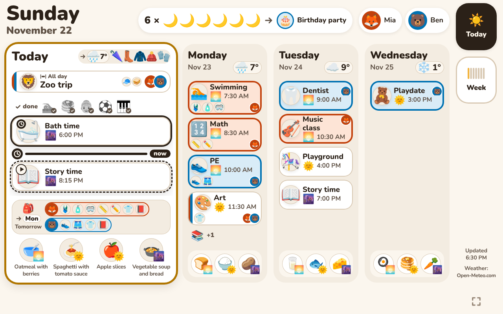
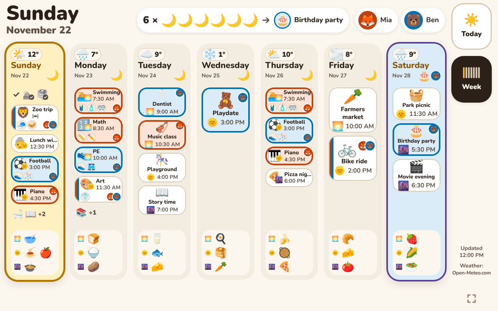
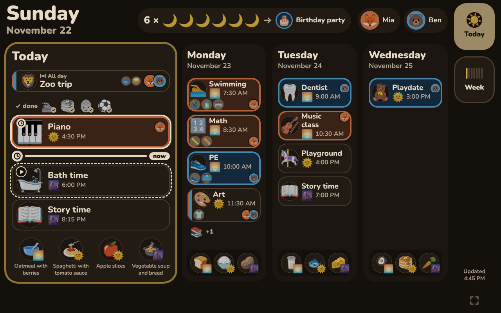
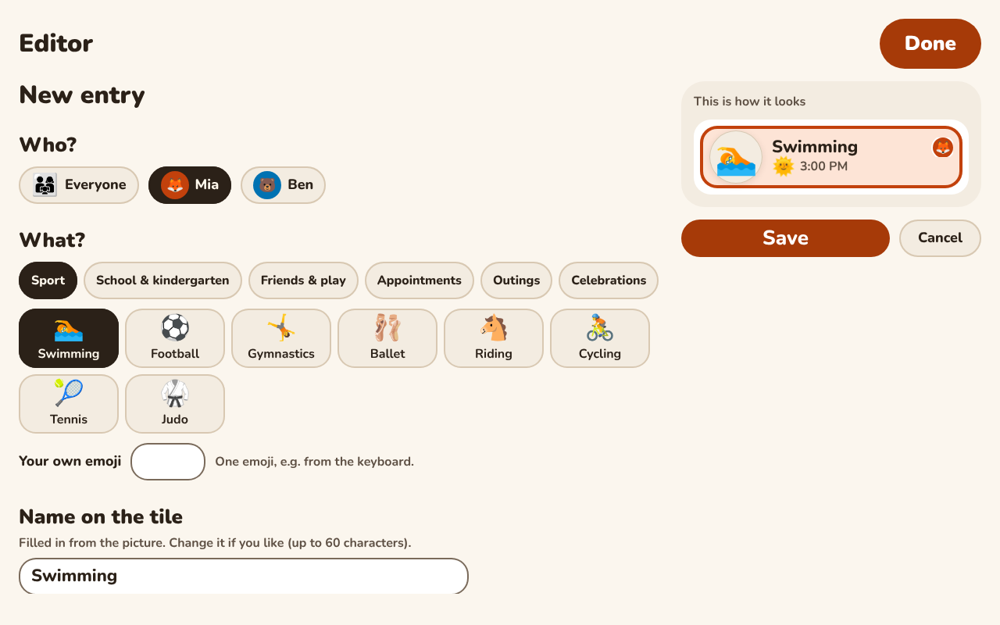
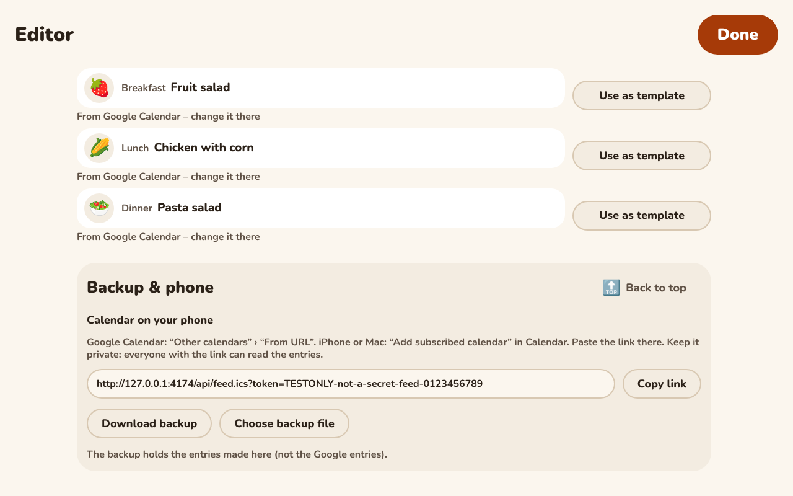
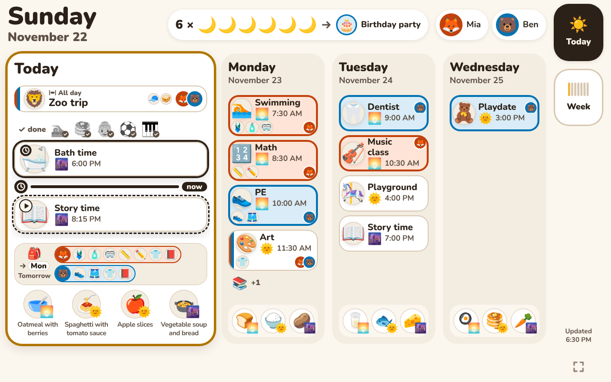
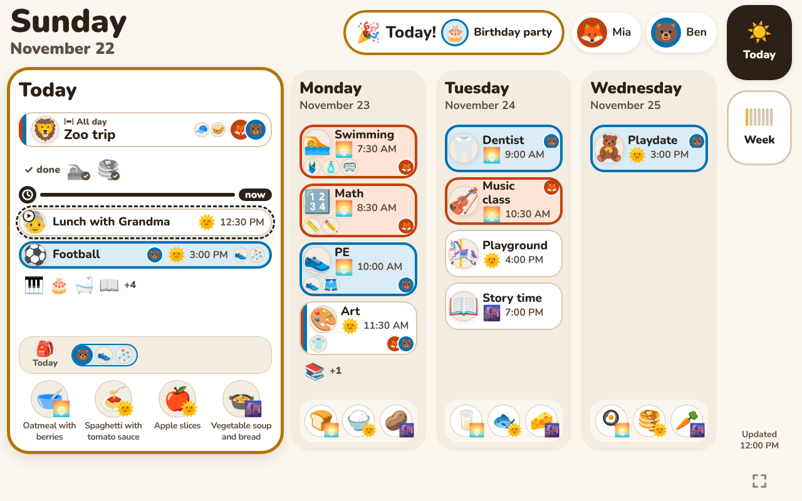

# KidBoard

[English](README.md) | [Deutsch](README.de.md)

An open-source, icon-first family calendar and meal plan for a wall-mounted tablet in kiosk
mode. Built for children (about 3-8) who cannot read yet: big pictures instead of text, so
they can see for themselves what today brings, what to pack and what to wear.

Parents add entries **right in the app**, on the tablet or a phone, behind a PIN: pick the
child, pick a picture, once or every week, done. KidBoard keeps them in your own Cloudflare
account, so there is nothing else to set up. Already using Google Calendar? You can show
those calendars too, as an option.



## What it does

- **Today and the next days:** today is a large card (all-day events as a banner, a "done"
  strip, a "now" line, the next event highlighted), followed by the next three days. A
  week view shows seven days at a glance, with meals in every column.
- **Parent editor:** add and change entries on the tablet: who, what (more than 40 activity
  pictures in six groups, or your own emoji), when, once or weekly (every week or every two
  weeks), what to bring, "count the sleeps". A live preview shows the tile before you save.
  "Again" suggestions and quick picks make recurring things a two-tap job.
- **Meal plan:** "Add a meal" with a picture catalogue of dishes, shown as plates
  under each day; last week's meals can be repeated in one step.
- **School: what to bring:** small pictures on the tile (👟 🩱 🧴), and from the evening
  before a 🎒 area on today's card tells each child what to pack.
- **Weather and what to wear (optional):** a weather icon with the temperature on every
  day, and clothing pictures (jacket, umbrella, warm hat, ...) for today; from the evening
  on for tomorrow.
- **"How many sleeps?":** moons count the nights until birthdays and holidays; on the big
  day it turns into a party popper.
- **Calendar on your phone (optional):** subscribe to the entries in Google Calendar or the
  iPhone Calendar with a private link.
- **Backup:** download all entries as a file and import them again.
- **Google Calendar (optional):** read-only, in addition to the entries made in the app.
- **Made for the wall:** one colour and emoji per child, night mode, works offline with the
  last good plan, keeps the screen awake, protects the display against burn-in, returns to
  the overview by itself. German and English.

## Screenshots

Synthetic demo data (generated with `pnpm screenshots`; 2000x1200 versions and more states
are in [`docs/screenshots/`](docs/screenshots/)).

| Week view with weather                                                      | Night mode                                                    |
| --------------------------------------------------------------------------- | ------------------------------------------------------------- |
|  |  |

| Parent editor: new entry                                             | Backup and phone link                                                        |
| -------------------------------------------------------------------- | ---------------------------------------------------------------------------- |
|  |  |

| The evening before school: what to pack                                              | The countdown on the big day                                                  |
| ------------------------------------------------------------------------------------ | ----------------------------------------------------------------------------- |
|  |  |

## Try it

The demo runs locally with synthetic data and a fake server, no account needed (Node 22,
pnpm 10):

```sh
pnpm install
pnpm dev:demo
```

The demo shows its PIN (`123456`) on the PIN pad.

## Get your own KidBoard

KidBoard runs on **Cloudflare Workers**; the free plan is enough for a family. There is no
central service: every family runs its own copy.

[](https://deploy.workers.cloudflare.com/?url=https://github.com/FinkeFlo/kidboard)

1. Click the button, log in to Cloudflare and connect GitHub or GitLab.
2. Fill in three fields:
   - `KIDBOARD_ACCESS_TOKEN`: a random string of 32 to 256 letters and digits
     (`_` and `-` allowed), e.g. from `openssl rand -hex 32`. It is required: without a valid
     one the API refuses everything. It protects your data and is needed for the editor.
   - `KIDBOARD_PARENT_PIN`: 6 to 12 digits; unlocks the editor. Not a repeated digit or a run like
     `123456` (the editor stays off then), and no birthdays.
   - `KIDBOARD_CONFIG`: your children (name, colour, emoji) and time zone as one line of
     JSON. Change the example names. Replace every `REPLACE_ME`.

   Keep the suggested storage (`KIDBOARD_CACHE`, `KIDBOARD_DATA`): Cloudflare creates it.

3. Deploy, then open `https://<your-worker>.workers.dev/?key=<token>` **once** on the
   tablet. The board remembers the token and removes it from the address bar.

**Your copy does not update by itself.** The button creates a separate copy of KidBoard in
your GitHub/GitLab account; Cloudflare rebuilds it whenever that copy changes, but changes
to this repository do not reach it automatically. To hear about new versions, watch this
repository's releases on GitHub (Watch > Custom > Releases). Your entries stay when you
redeploy, but a new version can tighten the rules for settings and secrets: read the
checklist below before you update.

**Upgrading from an earlier version.** Check these five points before or right after the
update; otherwise the board may answer with an error (`KB-500`) or the editor stays off:

1. **Access token required.** Without a valid `KIDBOARD_ACCESS_TOKEN` (32 to 256 characters
   `A-Z a-z 0-9 _ -`) the API now refuses everything. A shorter token, or one with `+`, `/`
   or `=` (for example from `openssl rand -base64`), no longer works: create a new one
   (`openssl rand -hex 32`), set the secret and open the tablet link with the new
   `?key=<token>` once. A public board needs `KIDBOARD_PUBLIC="1"` and no token.
2. **Child colours.** In `KIDBOARD_CONFIG` only `child-1` ... `child-6` or hex (`#rgb`,
   `#rrggbb`) are valid; a name like `"red"` or `rgb(...)` makes the whole configuration
   invalid. Change them, e.g. `"red"` to `"#cc0000"`.
3. **PIN.** A PIN with one repeated digit or a run like `123456` switches the editor off
   (the log says why). Choose another PIN.
4. **Embedding.** Other sites can no longer embed the board in a frame (for example a Home
   Assistant dashboard). Add the dashboard's address to `FRAME_ANCESTORS` in
   `apps/web/headers/staticHeaders.ts`, see [docs/DEPLOY.md](docs/DEPLOY.md).
5. **Calendar addresses.** Feed URLs must start with `https://` (or `webcal://`); an
   `http://` address is now refused. Copy the secret iCal address again from Google Calendar.

Step by step, the local command-line way, custom domain and logs:
[docs/DEPLOY.md](docs/DEPLOY.md). All settings: [docs/CONFIG.md](docs/CONFIG.md).

## The parent editor

- **Open it:** press and hold the small pencil in the side bar for 2 seconds, then type the
  PIN. Short taps do nothing, so children do not end up in it by accident.
- **New entry:** choose who, the picture, the day and time (or all day), and whether it
  repeats. The name on the tile is filled in from the picture; change it if you like.
- **Change or delete:** tap "Change". For a weekly entry you choose "only on <day>" or
  "whole series".
- **Locks itself** after 3 minutes without input, when you tap "Done" and when the screen
  turns off. After 5 wrong PINs it locks for 15 minutes; each further lockout doubles the
  time (up to 2 hours), and the right PIN resets it.
- **Calendar on your phone:** set the optional secret `KIDBOARD_FEED_TOKEN` (32 or more
  letters and digits). The "Backup & phone" section then shows a link to subscribe to; keep
  it private, anyone with the link can read the entries.
- **Backup:** "Download backup" saves the entries made in the app as a file; "Choose backup
  file" adds them again or replaces everything.

Changes show up on the board right after saving.

## Weather

Add a place to `KIDBOARD_CONFIG`, for example `"weather": { "place": "Hamburg", "country":
"DE" }`. The forecast comes from [Open-Meteo.com](https://open-meteo.com/) (no account, no
key), fetched by your server; the place never reaches the tablet. Details and the clothing
rules: [docs/CONFIG.md](docs/CONFIG.md#weather).

## Optional: Google Calendar

If your family already plans in Google Calendar, KidBoard can show those calendars as well
(read-only; change those entries in Google). For each calendar:

1. Google Calendar (web): Settings > your calendar > "Integrate calendar" > **Secret address
   in iCal format**. Treat it like a password.
2. Add the calendar to `calendars` in `KIDBOARD_CONFIG`, for example
   `{ "id": "kids", "kind": "events" }` or `{ "id": "meals", "kind": "meals" }`.
3. Add a secret `CAL_<ID>_URL` with the address (id in upper case: `kids` ->
   `CAL_KIDS_URL`) in Cloudflare: your Worker > Settings > Variables and Secrets.

Use your own secondary calendars (for example "Kids" and "Meals") instead of your main
calendar: the main calendar's feed also lists invitations you have not accepted yet. Only
`https://` (or `webcal://`) addresses are accepted. A calendar that failed is not fetched
again for 5 minutes; per calendar at most 2000 events are read and titles are cut at 120
characters.

Google updates the feed with a delay and KidBoard caches it (default one hour), so new
Google events take a while to appear. Entries made in the app show up at once.

<details>
<summary><b>How Google event titles become pictures</b></summary>

The title is the only interface: write it, KidBoard turns it into a picture. The editor
writes the same format, so app and Google entries look alike.

- **Emoji = the picture.** An emoji at the start of the title becomes the icon, and the rest
  is the title: `⚽ Football`. Any single emoji counts, including skin tones and flags.
- **No emoji:** KidBoard looks for a known word (German and English, e.g. Kita, dentist,
  swimming, birthday, piano) and uses a matching icon; otherwise events get 📅 and meals 🍽️.
  School subjects get an icon too: Art 🎨, PE 👟, Music 🎵, Math 🔢, German/English 📖,
  Science 🔬, Crafts 🔨, Swimming lessons 🏊.
- **Children:** name(s) in front, followed by a colon: `Mia: 🩰 Ballet`, `Mia, Ben: 🛁 Bath`.
  `All:` / `Alle:` / `Everyone:` means all children. Without a name, an event belongs to the
  child of its calendar (`childId`), or to everyone.
- **Meals** (meal calendar only): `Breakfast:` / `Lunch:` / `Dinner:` (German `Frühstück:` /
  `Mittag:` / `Abend:`), for example `Lunch: 🍝 Spaghetti`. Without a slot word a timed meal
  is sorted by its time.
- **Countdown:** icons in the countdown list (default 🎂 🎉 🎁 🎄 🐣 ✈️ 🏖️) get "How many
  sleeps?"; for any other event write `#countdown` in the description.
- **Bring list:** a line of its own in the **description** that starts with `Bring:` (or
  `Mitbringen:`), for example `Bring: 👟 🩱 🧴`. Only the emoji are used, at most 8; the
  rest of the description never leaves the server.
- Titles are plain text: formatting or HTML is shown as typed, never interpreted.

| Event title (calendar)         | Icon          | Title     | Children | Meal slot |
| ------------------------------ | ------------- | --------- | -------- | --------- |
| `⚽ Football` (Ben's calendar) | ⚽            | Football  | Ben      | -         |
| `Mia: 🩰 Ballet`               | 🩰            | Ballet    | Mia      | -         |
| `All: 🌳 Zoo trip`             | 🌳            | Zoo trip  | everyone | -         |
| `Dentist`                      | 🦷 (fallback) | Dentist   | everyone | -         |
| `Lunch: 🍝 Spaghetti` (Meals)  | 🍝            | Spaghetti | -        | lunch     |

Full rules: [docs/ARCHITECTURE.md](docs/ARCHITECTURE.md#title-conventions-parsing-rules).

</details>

## Bring list

Children should know what to pack: PE kit, swimsuit, paint shirt. In the editor tap the
items under "Bring along" (or add your own emoji); for Google events write a `Bring:` line
into the description (see above).

- The pictures appear as small chips on the event's tile until the event is over.
- From the evening before (`bands.eveningStart`, default 17:00) today's card shows a 🎒
  area with tomorrow's items, one row per child, marked "Tomorrow". After midnight it says
  "Today", and each event's items disappear when it starts (all-day events: at
  `bands.middayStart`, default 11:00). When nothing is left to pack, the area disappears.
- For a weekly lesson set the items once; they apply to every week.

## Kiosk tips

- **Fully Kiosk Browser (Android):** set the start URL to your board address (with `?key=`
  once), keep the screen on, enable kiosk mode, reload on network reconnect. Leave "clear
  cache/data on start" off, otherwise the stored token and the offline plan are lost.
- **Installed app:** in Chrome choose "Install app" / "Add to Home screen"; it runs
  fullscreen and keeps working offline. Open the `?key=` link once inside the installed app.
- **Fullscreen:** press and hold the small symbol at the bottom of the side bar.
- **Screen:** KidBoard asks the browser to keep the screen awake, but Android may refuse in
  battery saver mode; also enable "keep screen on" in the kiosk browser and keep the tablet
  plugged in. Night mode (default 19:30-06:30) only darkens the colours. The board moves by
  a few pixels now and then against burn-in; this is intended.
- **Emoji:** KidBoard uses the tablet's own emoji. Everything built in works on Android 11 or
  newer; very new emoji you type yourself may show as a box on older tablets.
- **Testing:** `?night=1` / `?night=0` forces night or day, `?burnin=0` ... `?burnin=7` pins
  the burn-in shift. Neither is stored.

## Troubleshooting

| What you see                                                 | What to do                                                                                                                                                     |
| ------------------------------------------------------------ | -------------------------------------------------------------------------------------------------------------------------------------------------------------- |
| "This tablet needs a new access link" (**KB-401**)           | The access token is missing, wrong or was changed. Open the tablet link with `?key=<token>` once more.                                                         |
| No pencil in the side bar                                    | The editor is off: `KIDBOARD_PARENT_PIN` must be 6 to 12 digits and not easy to guess (`111111`, `123456`), and `KIDBOARD_ACCESS_TOKEN` must be a valid token. |
| "The editor is switched off."                                | Same as above; after changing a secret, reload the board.                                                                                                      |
| "Offline · as of ..." (**KB-OFF** if there is no saved plan) | No internet. The last good plan stays visible; the board reloads by itself when the network is back.                                                           |
| "Can't update · as of ..."                                   | The tablet cannot reach the server; the last good plan stays. Check Wi-Fi; it retries by itself.                                                               |
| "Maybe not current · as of ..."                              | The server could not reach a Google calendar and shows the last good copy (up to 7 days). Check that calendar's secret address.                                |
| Wrong day, or times shifted by hours                         | Set `timeZone` in `KIDBOARD_CONFIG` (e.g. `Europe/Berlin`). The tablet's own time zone is ignored on purpose.                                                  |
| A Google calendar is empty or missing                        | Is `CAL_<ID>_URL` set and does `<ID>` match the calendar `id`? Is it the secret iCal address? New Google events can take an hour or more.                      |
| "Back in a moment" with an error code                        | A reload usually fixes it ("Reload now"). The code tells a helper what happened, see below.                                                                    |

<details>
<summary><b>Error codes</b> ("Error code for parents" on the error card)</summary>

| Code      | Meaning                                                                                                        |
| --------- | -------------------------------------------------------------------------------------------------------------- |
| `KB-NET`  | The tablet cannot reach the server (Wi-Fi, DNS, server down).                                                  |
| `KB-TIME` | The server took too long to answer.                                                                            |
| `KB-401`  | Access token missing or wrong. Open the tablet link with `?key=` again.                                        |
| `KB-400`  | The server rejected the request (for example an outdated app version). Reload the page.                        |
| `KB-502`  | No calendar could be loaded and there is no saved copy. Check the Google calendar links.                       |
| `KB-500`  | Server problem, usually missing or invalid `KIDBOARD_CONFIG` or a missing, short or `REPLACE_ME` access token. |
| `KB-HTTP` | Another unexpected HTTP answer. Check the deployment and its logs.                                             |
| `KB-DATA` | The answer had an unexpected format (app and worker versions differ). Redeploy, reload.                        |
| `KB-OFF`  | Offline and no plan saved yet.                                                                                 |
| `KB-UI`   | The display itself failed; KidBoard restarts it on its own.                                                    |
| `KB-LOAD` | Loading failed for an unknown reason.                                                                          |

Server-side problems: [docs/DEPLOY.md](docs/DEPLOY.md#9-troubleshooting).

</details>

## Privacy

KidBoard has no accounts, no analytics and no trackers, and there is no central server. The
entries you make in the app are stored in a database in **your own** Cloudflare account. The
PIN and the access token are secrets in that account; the tablet keeps only the token and
the last plan (for offline use). If you add Google calendars, their secret addresses
stay on the server, and of an event's description only the emoji of a `Bring:` line reach
the tablet. With weather on, the server sends your place to Open-Meteo, nothing else. The
access token is required: without a valid one the server refuses every request, so the plan is
never public by accident (a public board needs the explicit `KIDBOARD_PUBLIC="1"`).

## Development

Requires Node 22 and pnpm 10.

```sh
pnpm install
pnpm dev            # web (Vite) + worker (wrangler dev)
pnpm dev:demo       # web only, with demo data and a fake API
pnpm lint
pnpm format:check
pnpm typecheck
pnpm test
pnpm build
```

`pnpm dev` needs a `.dev.vars` file (copy `.dev.vars.example`): the worker refuses requests
without a valid `KIDBOARD_ACCESS_TOKEN`; for a quick local look without a token set
`KIDBOARD_PUBLIC="1"` instead. `pnpm dev:demo` needs neither.

See [CONTRIBUTING.md](CONTRIBUTING.md) and the [architecture](docs/ARCHITECTURE.md).

## License

[MIT](LICENSE) (c) 2026 FinkeFlo
