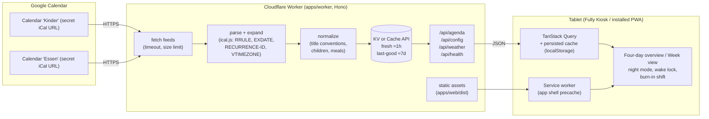

# KidBoard – Architecture

> Engineering docs (plan, ADRs, architecture, progress) are written in English so that
> contributors worldwide can follow them. User-facing docs (README, CONTRIBUTING) are
> bilingual (EN + DE). See [ADR-0001](adr/0001-stack.md).

## Overview

KidBoard is an icon-first family calendar and meal plan for a wall-mounted tablet.
Parents keep entries in Google Calendar (KidBoard reads the calendars' **secret iCal
addresses** on the server side, read-only) and/or in the parent editor of the app (entries
stored in D1, ADR-0014). The worker normalizes both and serves a small JSON API to a
kiosk-friendly PWA.



* iCal URLs are **Worker secrets** (`CAL_<ID>_URL`). They never reach the client bundle,
  logs or fixtures.
* Non-secret settings (children, colors, locale, time zone, day bands, night mode) live
  in one JSON document (`KIDBOARD_CONFIG` variable, shape documented in
  `config.example.json`). The worker validates it and exposes the public part at
  `/api/config`.
* One deployable unit: a single Worker serves the SPA as static assets and handles
  `/api/*` first (`run_worker_first`). See [ADR-0002](adr/0002-hosting.md) and
  [Deploy & static headers](#deploy--static-headers-t-25).

## Repository layout

```
apps/
  web/        Vite + React PWA (UI only, talks to /api)
  worker/     Cloudflare Worker (Hono): feeds → JSON API, serves web/dist
packages/
  shared/     Pure TypeScript: data model, config schema, title parser,
              date helpers. No DOM, no Worker globals. Used by both apps.
docs/         Plan, ADRs, architecture, progress, design hand-off
wrangler.jsonc       The only Wrangler config (root: Deploy button + Workers Builds)
.dev.vars.example    Worker secrets template (local `.dev.vars` lives next to it)
```

## Data model (TypeScript)

```ts
/** A configured child. Color is a design-token name or a CSS color. */
export interface Child {
  id: string;            // slug, e.g. "mia"
  name: string;          // "Mia" – also the title prefix "Mia: …"
  color: string;         // e.g. "#E4572E" or token "child-1"
  avatar: string;        // emoji, e.g. "🦊"
}

export type CalendarKind = 'events' | 'meals';

/** One configured iCal feed. The URL itself is a secret and never part of this type. */
export interface CalendarSource {
  id: string;            // "kinder", "essen", "mia" … → secret CAL_<ID>_URL
  kind: CalendarKind;
  childId?: string;      // feed belongs to exactly one child (one calendar per child)
  label?: string;
}

export type MealSlot = 'breakfast' | 'lunch' | 'dinner' | 'unspecified';

/** One concrete occurrence (recurrences are already expanded server-side). */
export interface CalendarEvent {
  id: string;            // stable: `${sourceId}:${uid}:${recurrenceId}` hashed
  sourceId: string;
  title: string;         // display title, emoji and prefixes stripped, plain text
  icon: string;          // leading emoji, or fallback icon
  iconIsFallback: boolean;
  childIds: string[];    // [] = for everyone
  allDay: boolean;
  start: string;         // ISO 8601 with offset (timed) or YYYY-MM-DD (all-day)
  end: string;           // exclusive end, same format as start
  countdown: boolean;    // special event for the "how many sleeps?" countdown
  bring?: string[];      // bring list from the description (rule 7), each one emoji,
                         // max 8; omitted when empty (old data without it stays valid)
}

export interface Meal {
  id: string;
  sourceId: string;
  date: string;          // YYYY-MM-DD in the configured time zone
  slot: MealSlot;
  title: string;
  icon: string;
  iconIsFallback: boolean;
}

export interface AgendaResponse {
  generatedAt: string;   // ISO timestamp of the underlying data
  timeZone: string;      // e.g. "Europe/Berlin"
  range: { from: string; to: string };  // YYYY-MM-DD, `to` exclusive
  stale: boolean;        // true = at least one source served from last-good cache
  sources: Array<{
    id: string;
    status: 'ok' | 'stale' | 'error';
    fetchedAt?: string;  // when the served data was fetched (absent for 'error')
    truncated?: boolean; // true = recurrence expansion hit a cap (ADR-0003)
  }>;
  events: CalendarEvent[];
  meals: Meal[];
}
```

## Title conventions (parsing rules)

Parsing happens server-side in `packages/shared` (pure function, heavily unit-tested).
Order of operations on the raw `SUMMARY`:

1. Trim; collapse inner whitespace. Treat as **plain text** (never HTML).
2. **Child prefix** – `Name: rest` where `Name` matches a configured child's name
   (case-insensitive, Unicode-aware) or `Alle:` / `All:` / `Everyone:` (= all children).
   Several children: `Mia, Ben: …` or `Mia + Ben: …`. Unknown names are left untouched
   (so `Tipp: …` stays a title).
3. **Meal prefix** (meal calendars only) – `Frühstück:`/`Breakfast:`, `Mittag:`/
   `Mittagessen:`/`Lunch:`, `Abend:`/`Abendessen:`/`Dinner:` (case-insensitive).
   No prefix → `unspecified` slot.
4. **Leading emoji** – the first grapheme cluster, if it is an RGI emoji (incl. ZWJ
   sequences like 👨‍👩‍👧, skin tones like 👋🏽, flags, keycaps), becomes `icon`.
   Detection uses `emoji-regex` on the first `Intl.Segmenter` grapheme.
5. **Fallback icon** – if no emoji: keyword table (DE + EN, e.g. "Kita"→🏫,
   "Geburtstag"/"birthday"→🎂, "Arzt"/"doctor"→🩺; school subjects: Kunst/art→🎨,
   Sport/PE→👟, Musik/music→🎵, Mathe/math→🔢, Deutsch/Englisch→📖, Sachkunde/science→🔬,
   Werken/crafts→🔨, Schwimmunterricht→🏊; never 🎒, which is reserved for the bring area;
   every built-in emoji is Emoji ≤ 13.0, ADR-0011), else 📅 for events and 🍽️ for meals.
6. **Countdown flag** – `true` if the icon is in `config.countdown.emojis`
   (default 🎂 🎉 🎁 🎄 🐣 ✈️ 🏖️) or the event description contains `#countdown`.
7. **Bring list** (events only, ADR-0010) – `parseBringList(description)` in
   `packages/shared`: a description line that starts (after optional whitespace and
   `-`/`*`/`•` bullets) with `Mitbringen:` or `Bring:` (case-insensitive, whole word,
   optional space before the colon) contributes its emoji graphemes (same detection as
   rule 4) to `bring`; words, digits and text-style symbols are dropped, duplicates
   (ignoring VS16) removed, at most 8 icons, several bring lines merged in order. Simple
   HTML of formatted descriptions is understood for matching only (`<br>`, `</p>`,
   `</div>`, `</li>` = line break; `<script>`/`<style>` with content and all other tags
   removed; `&nbsp;`/`&amp;` decoded). Bounded: first 8 KB (8 192 UTF-16 code units) of
   the description, graphemes starting in the first 500 code units of a bring line.
   Meals ignore bring lines; `#countdown` and a bring line can share a description.
   Nothing else of the description is ever part of a response, log or error.

| Raw `SUMMARY` (calendar) | icon | title | children | slot |
|---|---|---|---|---|
| `⚽ Fußball` (Ben's calendar) | ⚽ | Fußball | ben | – |
| `Mia: 🩰 Ballett` | 🩰 | Ballett | mia | – |
| `Mia, Ben: 🛁 Baden` | 🛁 | Baden | mia, ben | – |
| `🏫 Kita` (Kinder) | 🏫 | Kita | (all) | – |
| `Zahnarzt` | 🦷 (fallback) | Zahnarzt | (all) | – |
| `Mittag: 🍝 Spaghetti` (Essen) | 🍝 | Spaghetti | – | lunch |
| `Dinner: Pizza` (Essen) | 🍕 (fallback) | Pizza | – | dinner |
| `🥣 Müsli` (Essen) | 🥣 | Müsli | – | unspecified |

| Description line (event) | `bring` |
|---|---|
| `Mitbringen: 👟 Turnschuhe, 🩱` | 👟 🩱 |
| `- bring : 🧴 🧢` | 🧴 🧢 |
| `<b>Mitbringen:</b>&nbsp;🎨` (formatted) | 🎨 |
| `Bitte mitbringen: 👟` / `Bringdienst: 👟` | – (no match) |

## Time handling

* All server-side expansion runs in the configured IANA zone (default `Europe/Berlin`);
  output offsets and the `[from, to)` window are in that zone (details: ADR-0003).
* TZIDs that are IANA zones are converted with the runtime tz database (`@date-fns/tz`
  `tzOffset`), whether or not the feed has a `VTIMEZONE` for them; non-IANA TZIDs use the
  feed's `VTIMEZONE` via ical.js; floating times and unknown TZIDs use the configured
  zone. `VTIMEZONE`s are not registered globally in `ICAL.TimezoneService`.
* DST: non-existent local times (spring-forward gap) use the offset before the gap
  (02:30 → 03:30), ambiguous ones (fall-back) the first occurrence (RFC 5545 §3.3.5).
* Recurrences are fast-forwarded where provably equivalent and capped per series and
  per feed (CPU budget, ADR-0003); a hit cap is reported as `truncated`.
* Day boundaries, bands (morning/midday/evening) and "nights until" are computed with
  `@date-fns/tz` (`TZDate`, `tzOffset`) in the configured zone, not the device zone;
  "nights until" is the calendar-day difference of the date keys (T-19).
* "Today" (`YYYY-MM-DD` in the configured zone) comes from one shared helper,
  `todayInZone` in `packages/shared` (`@date-fns/tz` `tzOffset`), used by the worker
  window and the client's `range.from`, so both always name the same day.
* All-day events use date-only strings with exclusive end, multi-day events appear on
  every covered day.

## Editor (T-39, ADR-0014)

The parent editor stores its entries in the worker's D1 database (ADR-0014); Google
Calendar stays read-only (the Google write path of ADR-0012 was never taken up and its code
is removed, see the git history). The model lives in `packages/shared/src/editor/` (pure,
runtime-agnostic, exported from `@kidboard/shared`) and is used by the web app, the worker
and the offline demo backend alike.

**Model.** `EditorEntryInputSchema` (zod, strict) is what the editor sends: `kind`
(`event`/`meal`), `childIds` (`[]` = everyone, always `[]` for meals), `icon` (one emoji),
`title` (trimmed, whitespace collapsed like `parseTitle`, 1-60 characters, one line),
`allDay`, `date`, `startTime`/`endTime` (`HH:mm`, end after start, default one hour later
on the wall clock, `endDate` for timed entries that end on a later day) or all-day
`endDate` (exclusive), `repeat` (`none` | `{ weekly: { weekdays 1-7, interval 1|2,
until? } }`, the first date must be a rule weekday), `bring` (up to 8 unique emoji,
events), `countdown` (events), `slot` (meals). `parseEditorEntryInput(value, config)` adds
the config checks (known children, a countdown icon implies `countdown: true`) and returns
issue codes for the UI.

**Titles and descriptions.** App entries are rendered to iCal and read back by the same
normalizer as the Google feeds, so they follow the same conventions: `composeTitle` writes
`[children: ][meal slot: ]icon text` (`Mia: 🏊 Schwimmen`, `Mittag: 🍝 Spaghetti`,
`Alle: ...`) and `composeDescription` writes the `Mitbringen:` / `Bring:` line and the
`#countdown` marker. `parseTitle` takes prefixes in any order until nothing changes, so a
text that itself starts with a child prefix gets an explicit child part; every result is
re-parsed, and anything that would not read back with the same children, icon, title and
slot throws `EditorCompositionError`. A generated round-trip table covers umlaut names,
child/meal-word/colon titles and ZWJ/VS16/skin-tone/flag/keycap icons.

**Times and recurrence.** All conversions take `config.timeZone` explicitly, never the
device zone. The single implementation of wall-clock to instant conversion (RFC 5545
gap/overlap rules) is `packages/shared/src/wallTime.ts` on `@date-fns/tz`; `editor/zonedTime.ts`
only adapts it to the editor's string forms. `resolveTimedRange` resolves start and end
together: without `endTime` the end is one hour later on the wall clock, or 60 real minutes
when the start lies in a spring-forward gap (Berlin 02:30 to 03:30-04:30); an explicit end
that is not after the resolved start is rejected (`time_range_invalid`), never clamped.
Shared tests run with the process zone set to `Pacific/Kiritimati` (vitest `env.TZ`) so any
use of the device zone fails. `buildRecurrenceRule` returns the rule value
`FREQ=WEEKLY;BYDAY=...[;INTERVAL=2][;UNTIL=...]` for ical.js when app entries are rendered;
`UNTIL` is a DATE for all-day series and, for timed series, UTC at the last second of the
last local day (computed with that day's offset).

**Shared item logic.** `editor/items.ts` holds what the editor list needs beyond the
model: `isOccurrenceDate`, `entryDateRange`, `splitResolvable`, the field-by-field items of
Google events and meals, `compareItems` and `buildTemplates`. The worker and the demo
backend (`apps/web/demo/fakeEditorApi.ts`) both use it, so list order and templates cannot
drift apart.

### Entry store (T-40, ADR-0014)

App entries live in the D1 database `KIDBOARD_DATA` (id-less binding, auto-provisioned).
`apps/worker/src/entries/schema.ts` creates the tables on first use: `kb_schema` (one
version row) plus forward-only, idempotent steps applied in one batch, so concurrent first
requests are safe; a `SchemaGate` remembers success per isolate. `EntryStore`
(`entryStore.ts`) is the only access path: `list(from?, to?)` (date pre-filter via stored
`first_date`/`last_date`), `get`, `create`, `update(id, revision, input)`,
`remove(id, revision)`, `addException(id, revision, date)` (EXDATE) and
`setOverride(id, revision, date, input)` (RECURRENCE-ID, a single replacement that may
move), `exportAll()` / `importAll(doc, "replace" | "merge")`. One row per entry: `id`
(`crypto.randomUUID()`), `revision` (optimistic concurrency, `UPDATE … WHERE revision = ?`
→ `conflict`), `kind`, `data` (`EditorEntryInput` JSON), `exdates`, `overrides` (keyed by
the original occurrence date), timestamps. Inputs go through `parseEditorEntryInput` (imports: shape only, see Editor API);
exception/override days must be occurrences of the series (weekday, `INTERVAL=2` week
parity, `until`); a series edit keeps only those that still are. Limits: 1 000 entries
(count check inside the `INSERT`; imports end with a guard insert into `kb_guard` whose
`CHECK` rolls the batch back; their base revision is read inside the same batch via `kb_meta`) and 8 KB per entry → `limit_reached`. Rows are re-validated
on read; a corrupt row is skipped and logged by failure type only. Every write
(`create`, `update`, `setOverride`, `addException`, `remove`, `importAll`) replaces the
change stamp `kb_meta.entries_stamp` (a random UUID, `entries/stamp.ts`) in the same
`db.batch` as the write itself: one transaction, so a committed write always comes with a
new stamp (a refused one may bump it too, which only costs a cache rebuild). `/api/config`
reports `editor: true` only with the binding, a valid `KIDBOARD_PARENT_PIN` and an access
token `KIDBOARD_ACCESS_TOKEN` (`editorEnabled` in `apps/worker/src/parent/pin.ts`; fail
closed: a missing, trivial or template PIN, or the binding without a valid token, logs a
configuration warning and keeps the editor, the app sources on the board and the phone feed
off); the key is omitted when false (older web bundles parse the config strictly) and `PublicConfigSchema` defaults it to `false` and strips
unknown top-level keys.

### App entries on the board (T-41, ADR-0014)

With the editor on, `/api/agenda` appends two virtual sources, `app-events` and
`app-meals` (reserved calendar ids, `RESERVED_CALENDAR_IDS` in `packages/shared`), after
the configured calendars. `apps/worker/src/entries/renderCalendar.ts` renders the stored
entries of one kind as an in-memory iCalendar with ical.js: `UID` = entry id, `SUMMARY`
via `composeTitle`, `DESCRIPTION` via `composeDescription("")` (bring line, `#countdown`;
meals none), `DTSTART`/`DTEND` as wall-clock times with `TZID` = config zone (no
VTIMEZONE; the expansion uses the runtime tz database) or `VALUE=DATE`, `RRULE` from
`buildRecurrenceRule`, one `EXDATE` per removed day and one `RECURRENCE-ID` VEVENT per
"only this day" override, both in the master's value type. An entry the config can no
longer express (removed child, …) is skipped, such an override hides its day; both are
logged by code and id only. The calendar then goes through `expandCalendar` and
`normalize` like a feed, so DST, gaps, bring lists, countdown and ids (hash of source,
UID and recurrence id: stable per entry and occurrence) behave as for Google events.

`apps/worker/src/agenda/appSources.ts` loads both sources per request: one primary-key
read of a random D1 change stamp (`kb_meta.entries_stamp`); a cached `SourceEntry`
(same store, keys and TTL as the feeds) is fresh only with that stamp, the current
window and version; otherwise the entries are listed once for both kinds (`list(window)`)
and rebuilt. The stamp is replaced inside each write's own batch (see the entry store),
so every isolate notices a committed write at once, which KV deletes alone would not
(eventual consistency, per-isolate memory). `invalidateAppSources` (called by the T-43
write routes after every successful write) only deletes both entries from this isolate's
memory and KV/Cache API. D1 unavailable or a render failure → the cached entry
as `stale`, else `error`; the configured calendars are unaffected. The D1 reads of one
request (stamp and entry list) share a deadline of 2.5 s (`APP_SOURCES_D1_TIMEOUT_MS`);
a hanging database counts as unavailable, so it never delays `/api/agenda`. With KV, the
TTL write-budget floor counts the two app sources.

### Parent lock (T-42, ADR-0013)

`apps/worker/src/parent/routes.ts` is mounted at `/api/parent` behind the access token.
Editor off (no `KIDBOARD_DATA`, no valid PIN or no access token) → every `/api/parent/*`
is `404`; bodies
are capped at 16 KB (`bodyLimit`, `413 payload_too_large`) and parsed with zod
(`http/jsonBody.ts`, `400 bad_request`). `POST /api/parent/unlock` `{ pin }` compares with
`tokensEqual` and returns `{ token, expiresAt }` (ISO UTC, now + 15 min); the token is
`v1.<exp epoch s>.<base64url HMAC-SHA-256 of "v1.<exp>">`, keyed by HKDF-SHA-256 over a
random 32-byte server secret (`kb_meta` key `parent_session_secret`, created with
`INSERT OR IGNORE` + read in one batch, then cached per isolate) with the PIN in `info`:
a new PIN or a new database ends every session. Wrong PIN → `403 wrong_pin` with
`attemptsLeft` (401 stays the access token's). Each attempt is reserved before the
compare (`parent/lockout.ts`, D1 only) by one D1 batch whose
conditional insert of a `kb_meta` row `parent_fail:<uuid>` → epoch s succeeds only
without an active `parent_lock_until` and with fewer than 5 rows in the last 15 min (older
rows are dropped); not reserved → `429 parent_lockout` with `Retry-After`, no compare. A
wrong PIN renames the row to `parent_fail:s:<uuid>` (a settled failure; still counted)
and, as the 5th in 15 min, writes `parent_lock_until` and raises `parent_lock_level` (the
lock lasts 15 min x 2^(level-1), capped at 2 h, also answered with 429); a right PIN deletes
its own row, every settled failure and the level, so earlier typos of the parent no longer
count. Reservations of parallel attempts
still being compared are kept, so at most 5 PINs are compared at once, and without the
right PIN at most 5 per window. If deleting the rows after a right PIN fails, the session is still issued and the delete is
retried once past the response (`waitUntil`); rows left behind age out with the window.
The lock condition counts all attempts in the window, including parallel ones still being
compared, not only settled failures: deliberately conservative; it differs only for
parallel attempts, which one tablet does not produce.
`requireParentSession` (`parent/session.ts`) guards editor routes: it verifies
`X-KidBoard-Parent` (canonical base64url, `crypto.subtle.verify`, `now < exp ≤ now +
15 min`) or answers `403 parent_locked`; `GET /api/parent/session` → `{ expiresAt }`. CORS (`http/cors.ts`):
only on `/api/parent/*` and only for listed origins are `POST, PATCH, DELETE`,
`Content-Type`, `X-KidBoard-Parent` allowed and `Retry-After` exposed.

### Editor API (T-43, ADR-0014)

`apps/worker/src/parent/editorRoutes.ts` adds the editor routes to the parent sub-app, so
the editor-off `404`, the 16 KB body limit and `requireParentSession` (`403
parent_locked`) apply; the response bodies are zod schemas in
`packages/shared/src/editor/api.ts` (`EditorListResponseSchema`,
`EditorWriteResponseSchema`, `EditorTemplatesResponseSchema`,
`EditorImportResponseSchema`, `EditorErrorResponseSchema`) for the web client. The routes
share the board's per-isolate sources (`agenda/board.ts`: memory layer, single flight,
schema gate) with `/api/agenda`.

* `GET /entries?from&days` (window rules of `/api/agenda`) → `{ timeZone, range,
  sources, items }`. App items come from D1 through the board's own path
  (`renderAppCalendar` + `expandCalendar`), one per occurrence: `entryId`, `revision`,
  the stored `entry`, `occurrenceDate` (series; the `date` of `scope=one` writes) and
  the `override` shown on that day. Google items reuse the cached, normalized feed data
  (`loadSource`, never a second fetch) and are built field by field (`origin: "google"`,
  title, icon, children, time, bring icons; never a description); a Google meal is a
  whole day in its slot. `sources` = status of the Google calendars. Order: day, all-day
  first, time, events before meals, slot, title.
  Stored entries the current config can no longer express (`parseEditorEntryInput`
  fails, e.g. a removed child) are not in `items` but in `unresolved` (`entryId`,
  `revision`, `entry`, `issues`), so a parent can change or delete them with their
  revision; entries whose date range does not touch the requested days are not checked.
  D1 unavailable → the Google items with `storageUnavailable: true` (no 503).
* `POST /entries` (body: `EditorEntryInput`) → `201`; `PATCH /entries/:id?scope=one|series&date=`
  (body `{ revision, entry }`; `scope` defaults to `series`; `one` writes an "only this
  day" override) and `DELETE /entries/:id?scope=one|series&date=&revision=` (`one`
  writes an exception) → `{ entry, boardRefresh: "now" }` (`entry: null` after a full
  delete). Series edits keep the exceptions and overrides whose dates still exist
  (`EntryStore.update`). Errors: `400 bad_request` (JSON, query), `404 not_found`,
  `409 conflict` (+ current `revision`), `422 invalid_entry` (+ `issues` with the
  `parseEditorEntryInput` codes and field paths, at most 50), `422 limit_reached`
  (+ `limit`: `entries`/`size`), `503 storage_unavailable` (D1 error, type logged only).
* `GET /templates` → up to 12 suggestions grouped by kind, icon (VS16 ignored), title
  and children; most occurrences first, then nearest to now. App entries count from
  today − 56 to today + 28; Google entries only within the cached window (today − 1 to
  today + 28),
  because looking further back would mean another fetch and expansion outside the CPU
  budget (ADR-0003); weekly Google series still count through their next four weeks.
  Titles or icons an app entry cannot hold are left out; times, slot, bring icons and
  countdown come from the occurrence nearest to now.
* `GET /export` → the `EntryStore.exportAll` document with `Content-Disposition:
  attachment; filename="kidboard-entries-<today>.json"` (exposed to listed CORS origins).
  `POST /import?mode=merge|replace` (mode required) → `{ mode, imported, created,
  updated, boardRefresh }` (`updated` = ids that were stored before the import).
  Imported entries are checked for their shape only, not against the config, so a
  backup from before a config change is restored and its leftovers surface as
  `unresolved` (`create`/`update`/`setOverride` still check the config);
  its body limit is `MAX_IMPORT_BODY_BYTES` (1 000 × (8 KB + 512 B) + 4 KB ≈ 8.3 MiB,
  enough for any export) instead of 16 KB and is checked after the session guard, so
  only an unlocked parent can make the worker read that much. The supported import size
  is the store limit (1 000 entries, ADR-0014), written in one D1 batch.
* Every write replaces the change stamp in its own batch; a successful one also calls
  `invalidateAppSources` before answering, so the agenda refetch the client starts at
  once shows the change.

**Web gate (T-44).** `apps/web/src/parent/`: with `config.editor` the nav rail shows a
quiet pencil (`ParentEntry`, 64 px) that opens the PIN pad only after a 2 s pointer,
Enter or Space hold (ring after 0.3 s, so short taps show nothing). The PIN pad takes at
most 12 digits and listens to the keyboard on the document while open (typing and
Escape keep working when a disabled key dropped the focus; Enter on a focused digit key
submits). `ParentGateProvider` holds
`closed → pin → editor` and the session token in React state only; `unlock` uses
`ApiClient.unlockParent` (same access token as the board, but no TanStack query, so a
403/429/401 never runs the board's 401 wipe). It locks on "Done"/cancel, when the tab is
hidden, after 3 min without input and at the session end (a 1 s tick compares
`Date.now()`, so sleeping timers cannot delay it); 30 s before the idle lock a calm
"locking soon" banner (`IdleWarning`, assertive live region) offers "Keep editing". A
late unlock answer is discarded.
A lockout (`Retry-After`) is remembered in memory and shown as minutes left. While open
the board is `inert` and its auto-return is paused. `EditorScreen` is the shell T-45 fills.

### Phone feed (T-46, ADR-0014 "Getting data out")

`GET /api/feed.ics?token=<KIDBOARD_FEED_TOKEN>` (`apps/worker/src/feed/`) publishes the
app entries for calendar apps on the parents' phones (read-only there).

* **On only when configured:** the editor is on (D1 + valid PIN + access token) and
  `KIDBOARD_FEED_TOKEN` is 32–256 characters of `A-Z a-z 0-9 _ -` without the template
  marker `REPLACE_ME` (`feed/token.ts`; e.g. `openssl rand -hex 32`). Unset → no feed;
  unusable → no feed and one warning per isolate (never the value). Every miss (feed
  off, missing or wrong `token`) is the plain `404 not_found` of unknown paths; the
  token is compared with `tokensEqual` (SHA-256 + `timingSafeEqual`). The parameter is
  `token`, distinct from the board's `key`: neither token opens the other's routes.
* **Token in the query string, not the path:** Workers Logs record the request URL of
  every invocation; `observability.redact_query_string` (`wrangler.jsonc`) drops query
  strings there, as for `?key=`. Worker log lines use `c.req.path`, which has no query.
  Calendar apps keep query strings of subscription URLs (Google "From URL" and Apple
  subscriptions fetch the URL as given; many published feeds carry tokens there); this
  is an assumption from common practice, no vendor documentation was available.
* **No access token:** calendar apps subscribe by URL only, so the access token
  middleware lets exactly `GET`/`HEAD` of the path `/api/feed.ics` through
  (`feed/path.ts` `isFeedRequest`); every other path or method still needs it. The
  feed token is the only guard of this route.
* **Body:** one calendar with events and meals (one subscription; meals all-day or
  timed exactly as stored), built from the same VEVENTs as the board's virtual sources
  (`appEventComponents` in `entries/renderCalendar.ts`): wall-clock times with
  `TZID` = the configured zone, `RRULE`/`EXDATE`/`RECURRENCE-ID` kept, so the feed
  expands to the board's occurrences (tested by parsing it back). Headers: `PRODID`,
  `CALSCALE`, `METHOD:PUBLISH`, `X-WR-CALNAME` (`KidBoard`), `X-WR-TIMEZONE`,
  `REFRESH-INTERVAL`/`X-PUBLISHED-TTL` `PT1H` (hints; Google polls on its own schedule).
  RFC 5545 requires a `VTIMEZONE` for each `TZID`: Google and Apple map IANA names
  themselves, but clients like Outlook need the definition, so the feed carries the
  configured zone's VTIMEZONE from `timezones-ical-library` (Apache-2.0, tzdb rules,
  TZID set to the configured name; tested to resolve to the board's instants across DST
  in three hemispheres). UTC times were rejected: a weekly `RRULE` in UTC drifts by an
  hour at every DST switch. A zone the library lacks → no VTIMEZONE (Google/Apple
  still work) and one warning.
* **Responses:** `200` `Content-Type: text/calendar; charset=utf-8`,
  `Cache-Control: no-store` (global middleware), all entries (no window). Invalid
  config → `500 server_misconfigured`; D1 unavailable → `503 storage_unavailable`
  (type logged only).
* **Subscribe link:** `GET /api/parent/feed` (parent session) → `{ feedUrl }` with the
  relative URL `/api/feed.ics?token=…`, omitted while the feed is off
  (`ParentFeedResponseSchema` in `packages/shared`). Rotating `KIDBOARD_FEED_TOKEN`
  revokes every subscription.

## Caching & offline (summary – details in [ADR-0006](adr/0006-caching-offline.md))

| Layer | What | Lifetime |
|---|---|---|
| Worker KV (or Cache API) "fresh" | normalized per-source result for the window | ~1 h (configurable) |
| Worker KV (or Cache API) "last-good" | same entry, after the TTL | ~7 days |
| Service worker (Workbox precache) | app shell, fonts, icons | until next deploy |
| TanStack Query persisted cache | last `/api/agenda` + `/api/config` | 7 days |

The client refetches every `refreshMinutes` (default hourly), on `visibilitychange`/`online`,
and after midnight (new day = new agenda query key, seeded from the cache meanwhile, T-16).

### PWA / service worker (T-14)

`vite-plugin-pwa` (`generateSW`, `registerType: 'autoUpdate'`), options in
`apps/web/pwa/options.ts`. The Workbox precache holds HTML, JS, CSS, the Nunito `woff2`
files and the icons; every navigation outside `/api/*` is answered with the precached
`index.html` (`navigateFallbackDenylist: [/^\/api\//]`), so the shell loads offline after
the first visit. `/api/*` is `NetworkOnly`: no API response and no request carrying the
bearer token ever enters Cache Storage. Manifest: `display: fullscreen`, `orientation:
landscape`, `theme_color` = `--color-accent`, `background_color` = `--color-surface`
(read from `tokens.css` at build time). Icons (any + maskable + Apple + favicon) are
generated on every build by `@vite-pwa/assets-generator` from the original artwork
`apps/web/public/kidboard-icon.svg` (`apps/web/pwa-assets.config.ts`). The app polls for a
new `sw.js` hourly; a new worker activates at once and the page reloads by itself.

### Night mode (T-21)

`apps/web/src/theme/`: `isNight(instant, nightMode, zone)` (pure) is true in
`[start, end)` of the wall clock of the config zone; `end` before `start` spans midnight
(19:30-06:30), `enabled: false` is never night. Wall-clock minutes mean a DST night
follows the clock face (skipped hour never matches, repeated hour matches twice).
`useNightTheme(nightMode, zone)` (called by `Board`) recomputes it on the minute clock
(`useNow`) and sets `<html data-theme="night|light">`, which swaps the colour/shadow
variables in `tokens.css`; Tailwind's `night:` variant matches the same attribute. Until
the config is known the theme is left untouched, and the first known value applies
without a fade. **Before first paint** a classic inline script in `index.html` re-applies
the last theme the board applied (`localStorage` `kidboard.theme`, written by
`rememberTheme` whenever the clock's theme is applied), so a cold start at night (config
not yet known, or failing from the start) shows the skeleton or error screen in night
tokens instead of a bright screen. Missing or blocked storage falls back to light tokens.
The script needs no network. The production CSP allows exactly this script by its
SHA-256 hash, computed from the built `index.html` when `dist/_headers` is generated
(see [Deploy & static headers](#deploy--static-headers-t-25)). While the theme changes the hook sets
`data-theme-switching` on `<html>` for 0.8 s, during which `global.css` fades the colours
over `--duration-slow` (variables do not animate on their own); under
`prefers-reduced-motion` the durations are 0 and the switch is instant. `?night=1|0`
forces night/day for testing; it is read once at startup and deliberately **not**
persisted, neither as a parameter nor as the remembered theme (a forgotten test link must
not pin a kiosk after the next clean reload).
`<Emoji>` dims every emoji at night itself (`night:brightness-75 night:saturate-80`, the
design hand-off's `brightness(0.75) saturate(0.8)`), so no caller handles it; a caller's
`grayscale` (past events) composes with it.
`<meta name="theme-color">` is updated at runtime to `--color-surface` in night mode and
restored to the build-time value (brand accent) by day. The manifest `theme_color` stays
static, because a manifest cannot change with the time of day; it only applies at
install/splash time.

### Kiosk: wake lock, fullscreen, boundary reset (T-20)

`apps/web/src/kiosk/`: `useWakeLock()` requests the Screen Wake Lock while the page is
visible and re-requests from the sentinel's `release` event (system release while still
visible; a kiosk rarely sees `visibilitychange`), on `visibilitychange` and on `focus`. A
rejected request (low battery, policy) is retried by a single timer (10 s, doubling, max
2 min; cleared on success and unmount); a missing API is a silent no-op. `useFullscreen()` wraps the Fullscreen API (`fullscreenchange`) and
reports `available: false` where unsupported or when the board already runs as an installed
app (`display-mode: standalone|fullscreen` without an active fullscreen element).
`FullscreenControl` is a fixed bottom-right corner overlay. `BoardFrame` reserves the
bottom strip for it (`pb-touch`, 64 px), so it never covers content; burn-in shifts (T-22)
stay inside that gutter: faint glyph, 64 px hit area, **long press (700 ms)** for
pointers so children cannot trigger it by accident; the request runs on pointer-up
(user gesture); keyboard/assistive-tech clicks act at once.
`AppErrorBoundary` resets itself after 5 s, doubling per failed retry up to 5 min; the
backoff starts over when the children ran 60 s without failing. The retry button resets
at once.

### Burn-in protection & banner slot (T-22)

`apps/web/src/burnin/`: `burnInOffset(stepIndex)` (pure) walks an 8-point square ring
(`BURN_IN_ORBIT`, units of `--spacing-burn-in` = 0.5 rem, i.e. 8 px at 1280x800 and 12 px at
2000x1200; the corners are the maximum shift); `burnInStepIndex(now)` = `floor(epoch /
5 min)`, so every device follows the same deterministic schedule (a full orbit takes 40 min).
`useBurnInShift()` reads it on the minute clock (`useNow`, no timer of its own).
`BoardFrame` applies it as a `transform` on an **inner wrapper** (`data-testid=burn-in-shift`),
never on `<main>`: `<main>` gives `burn-in` of its gutter back as the wrapper's padding, and
its bottom strip is `touch + burn-in` tall, so the shifted wrapper stays inside the original
gutter and above the fullscreen strip (amplitude 0.5 rem < gutter 1.5 rem; unit-tested
against the tokens). The step glides over `--duration-slow`; under `prefers-reduced-motion`
the durations are 0 (also `motion-reduce:transition-none`), so it jumps without animation.
`transform` is part of the `data-theme-switching` transition list (T-21), so a step that
coincides with the night switch (19:30/06:30 are step boundaries) does not jump.
Test hook: `?burnin=0..7` pins an orbit index (1, 3, 5, 7 = corners = max shift); read once,
not persisted. **Not shifted:** the fullscreen control (faint, fixed 64 px target in the
reserved corner: a stable target matters more than its negligible burn-in risk) and the
loading/error screens (transient, no board chrome).

The offline/stale banner no longer lives in the header: it has a fixed slot in the reserved
bottom strip, centred left of the fullscreen control (`inset-x-touch`). Appearing or
disappearing never reflows the header, so the view toggle keeps its place (e2e checks identical
toggle positions with and without banner, both views and viewports).

### Client data layer (T-13)

`apps/web/src/data/`: typed API client (zod-validated, 15 s timeout > worker's ~11 s
upstream budget, Bearer token from a one-time `?key=`), TanStack Query with the
localStorage persister, `useConfig()`, `useAgenda({ from, days })` and
`useConnectionStatus()` → `loading | ready | offline | stale | error`. A 502 or an
invalid response never replaces shown or persisted data; with data it shows as `stale`,
without data as `error`. A 200 agenda that is worker-stale or has a failed source is
`stale` too. A 401 wipes all calendar data (memory and storage) and the stored token:
status `error`, `useApiErrorKind()` = `unauthorized`. Persisted queries older than 7 days
are dropped, and so are agendas superseded by a later-fetched one that reaches at least
as far (T-19, ADR-0006). The config `locale` is applied to i18n as soon as the config is
known (fetched or restored). Rules in detail: [ADR-0006](adr/0006-caching-offline.md).

### Clock & day rollover (T-16)

`apps/web/src/time/`: pure logic in `clock.ts` (`startOfMinute`, `msUntilNextMinute`,
`minuteOfDay`, `bandOf(instant, bands, zone)` → `night | morning | midday | evening`,
boundaries belong to the later band, `night` = before `morningStart`; the day model
calls it directly with the minute-clock `now`, there is no band hook), hooks in
`hooks.ts`:

* `useNow()`: current time floored to the minute. One shared `setTimeout` chain
  (`minuteClock.ts`) wakes all consumers at each minute boundary; every delay is
  computed afresh from `Date.now()` (late or throttled timers and system clock jumps
  correct themselves at the next firing, nothing is accumulated). `visibilitychange`
  (visible) and `pageshow` wake it at once, so a tab that slept across midnight shows
  the new day immediately. The timer and listeners exist only while something is
  subscribed.
* `useToday(zone)`: `todayInZone(Date.now(), zone)`; changes exactly at local midnight
  of the config zone (minute boundaries are local minute boundaries for all
  whole-minute offsets), also on DST nights and when the DST change happens at midnight,
  whatever the device zone. Re-renders only when the date changes.

**Before the config has loaded** the time zone is unknown. KidBoard deliberately gates
instead of guessing a default zone: `useToday` returns `undefined`,
`useTodayAgenda` sends no agenda request (its agenda query stays pending, so the
connection status is `loading`, or `offline` without network), and views show their
loading state. A default such as `Europe/Berlin` would fetch and show the wrong day for
families in other zones and then jump. In practice the gate only applies to the very
first visit (or after 7 days without data): the persisted config is restored at
startup, also offline.

**Rollover:** `useTodayAgenda(days = AGENDA_DAYS)` (31: today plus the 30 days the
countdown looks ahead, T-19; day, week and countdown share this one query, its status
and its offline seed) = config zone → `useToday` → `useAgenda({ from:
today, days })`. At midnight the new `from` is a new query key, fetched at once. Until
that succeeds the new query is seeded (TanStack `initialData`, `initialDataUpdatedAt: 0`)
from the most recent cached agenda whose range covers the new day, re-scoped to the new
range (`agendaSeed.ts`; same overlap rules as the worker; `range.to` never claims days
the cache does not cover). Only real responses younger than 7 days qualify (the
persister's max-age rule, applied to in-memory data too; seeds never qualify), so over
several offline days each day is seeded from the last real response while it covers
the day. So offline or after a 502 the board keeps showing the last state with status
`offline`/`stale`, never empty or `loading`. A seed is never `ready`: an agenda query
whose data is a seed (`dataUpdatedAt` 0) or ends before `from + days` (from the query
key) counts as `stale` until the real response lands, also while that fetch is still
running online (both rules on purpose: even a seed that covers every requested day is
the last known state, not an answer for the new range). For one render right at the
rollover the status can still show the previous value, until the new query's observer
has subscribed. `initialData` rather than
`placeholderData`: placeholder data disappears once the fetch fails and is invisible to
the cache-based connection status. The seed is marked outdated (`dataUpdatedAt` 0), so it
is refetched regardless of `staleTime` and never persisted (the persister's per-query
7-day check drops it); a 401 wipes it like all agenda data. `useAgenda` waits for the
persisted cache to be restored before it creates the real query, so a reload on a later
day (offline) is seeded from the restored agenda.

### Overview: day model, columns and states (T-17, T-30b)

`apps/web/src/day/buildDayModel.ts` (pure, `buildDayModel(agenda, config, date, now)`)
decides what belongs to a date (a date key in the config zone) and in what order; every
instant is read in the config zone, never the device zone. `buildOverviewModel` calls it
for today plus three days and places the days into the **4 columns** of the overview
(today `2fr`, the others `1fr`), so overview, week and countdown agree on what belongs to
a day. **Placement rules:**

* **All-day events** (also multi-day ones) covering the date go to the day's all-day
  banner, in feed order. `end` is exclusive; a zero-length all-day event counts for its
  start day.
* **Timed events** belong to every date from the date of their start to the date of
  their last instant (`end - 1 ms`, so an event ending at midnight does not spill into the
  next day; a zero-length event stays on its start day). They form one list per column in
  time order (ties by title); an event that started on an earlier day comes first with a
  "continues" hint instead of its start time. There are no bands or band headings. Each
  event carries `timeOfDay` (`bandOf`, wall clock of the zone; a boundary belongs to the
  later band; before `morningStart` it counts as morning), which only picks the small
  morning / midday / evening symbol next to the time.
* **Status** only on today: an event is `past` once its end has passed (zero-length: after
  its start), `current` while running, else `upcoming`; all-day events are always
  `upcoming`. The model also gives today's `nowIndex` (events already started), `current`
  and `next` (first event not yet started). Past items recede via surface/text tokens (not
  opacity, WCAG AA).
* **Meals** of the date, ordered breakfast, lunch, dinner, unspecified.

**Column layout (space-based, nothing scrolls).** `useContentHeight` (a `ResizeObserver`
on the `flex-1 min-h-0` event list, first value measured in a layout effect before paint)
gives the list height and the root font size, so the height is handled in rem. `fitColumn`
decides by space alone, taking the first option whose real height fits (tiles
`TILE_HEIGHT_REM` plus `PROMINENT_EXTRA_REM`, the strip and "+N" rows `SUMMARY_ROW_REM`,
gaps and the now line): 1. every event as a tile at the largest size, the prominent tile
enlarged; 2. otherwise **all** past events fold into the "vorbei" strip (one deterministic
rule: past events are either all tiles or all folded, never a mix) and the rest shrinks step
by step (`TODAY_SIZES` large → medium → dense → slim, `DAY_SIZES` compact → compact-dense),
at each size first with, then without the enlarged prominent tile (sizes without an
enlargement, like slim, skip that try); 3. only then the latest upcoming events are summed
up in a trailing "+N" row at the smallest size, and only when one more tile would not fit
there. `slim` (2.75rem, title and time in one row) is today's last step, so a whole day
still fits where dense tiles would have needed "+N". The strip draws up to 8
grey icons with a check mark, but only whole ones: it measures its icon area
(`useContentWidth`) and `stripIconsThatFit` keeps as many as fit next to a "+N" that counts
the rest (never a clipped icon). "+N" shows the summed-up events as
small emoji followed by the count, as plain text (no border or fill, it is not a button).
A **current event is never hidden or folded**; `MIN_TILES` (1) is the smallest tile count,
so a tiny column may overflow rather than hide. Strip and "+N" name all their titles for
assistive tech, so nothing is lost silently.

**Bring chips (T-35, ADR-0010).** An event's `bring` list shows on its tile as small emoji
chips (`BringChips`: each icon through `<Emoji>` on a `--color-chip` disc with a
`--color-border` ring, `CHIP_DISC`; React text only). Only tiles that are not
over show them (`showsBring`); past tiles and the "vorbei"/"done" strip never do. Chips are
decorative (`aria-hidden`); the tile has one accessible description listing every icon
(`aria-describedby` → `event.bring`, "Bring along: 👟 🩱" / "Mitbringen: 👟 🩱"). Where they
go: in today's column (about twice as wide) at the end of the time row, `slim` at the end
of its one row (at most 40 % of it), the all-day banner before the badges; these tiles keep
their height and their 24px chips. The narrow tiles (`compact`, `compact-dense` and every
week size) have no room beside the time, so the chips (28px, `week-slim` 24px: its
7.7rem at 1280 and its place as the last step before "+N" cannot afford more) get a row
of their own and the tile grows by `BRING_EXTRA_REM` (the measured title lines, time row,
chip row, gaps and a little vertical padding that keeps the title off the edge, minus the
plain height: `compact` 2rem, `compact-dense` 1.625, `week` 1.875, `week-dense` 2,
`week-small` 1.875, `week-slim` 1.25). Where the picture sits beside the text
(`compact`, `compact-dense`, `week-slim`) that row spans the tile below picture and text
and ends with the child badges, so the title keeps the tile's whole width (`compact` two
lines); stacked week tiles keep the badges beside the emoji. `tileHeightRem`,
`fitColumn`/`freeRem` and `fitWeekColumn` (`weekRowsRem`) count exactly those tiles taller,
so the space rules (fold, shrink, then "+N" only when one more tile would not fit) and
`shown + folded + summed up = n` hold with bring lists too. The chip area asks for the
width of all chips and shrinks first (`shrink-999`) down to the room of a "+N"; it measures
the width it got (`useContentWidth`) and `chipsThatFit` (the strip's `iconsThatFit`) draws
only whole chips, the rest is a plain-text "+N". Its width never depends on how many it
draws, so the measurement is stable. The disc is `--color-chip` (T-36): the emoji
disc colour by day; at night lighter than every surface and tint (night `#6b5c4e`), so a
black glyph and a white one after the night dimming both keep >= 3:1 (`tokens.test.ts`);
its "+N" is `--color-text-muted` on the tile (contrast-tested on every tint, both themes).

**Evening-before 🎒 area (T-36, ADR-0010).** What to pack, per child, until the event has
started. `buildBringReminder(agenda, config, now)` (pure, `day/buildBringReminder.ts`) reads
`now` on the wall clock of the config zone (never the device zone): from
`bands.eveningStart` until midnight (`when: "tomorrow"`) it collects the bring lists of
tomorrow's events, from midnight until `bands.eveningStart` (`when: "today"`) those of
today's events that have not started yet. A timed event counts on the date it starts on
until its start instant; an all-day event on its first day until `bands.middayStart` (the
whole evening before); an event that started earlier and continues into the date, a later
day of a multi-day event and anything two days ahead never count. Each occurrence of a
series is its own event with its own list (an override carries its own). So the area
fills at eveningStart, switches to the morning variant at midnight and loses an event's
icons as it starts; it is empty (not rendered) when nothing is left. DST nights need no
special case: the switch points are wall-clock minutes (`minuteOfDay`), the start is an
instant. **Grouping:** events for everyone (`childIds: []`, or only children the config
does not know) form one neutral group shown first, then one group per configured child in
config order; an event for several children adds its icons to each; icons are
deduplicated per group (ignoring VS16, first spelling wins) in start order (all-day
first). **Data and clock:** the Board builds it from the same 31-day agenda as the
overview (it always holds today and tomorrow) and the minute clock (`useNow`), so it
switches without a reload, also offline: at midnight `useToday` seeds the new day from the
persisted agenda. **Placement:** only in today's overview column (`DayColumn` ignores it on
other days; the week view never gets it), between the event list and `MealPlates`.
`BringArea` is a labelled region (`section`, "Pack for tomorrow: …" / "Für morgen
einpacken: …", morning "Today bring: …" / "Heute mitbringen: …", the name lists every
child and icon via the locale's list format; not a live region, nothing interactive): 🎒,
then per group a pill (the child's tint, edge ring and avatar badge; the neutral group a
raised pill) with the icons as `CHIP_DISC` chips through `<Emoji>` (dimmed at night).
A head at the start says the day (decorative; the region's name says it in words): 🎒,
below it in the evening "→" with tomorrow's short weekday (`formatWeekdayShort` of
`reminder.date` in the config zone: "Mo" / "Mon") and "Morgen" / "Tomorrow", in the
morning "Heute" / "Today" (never 🌙, rule 1). Beside it **one row per group**, so every
child's icons show side by side, not behind a "+N". The height is fixed by the row count
and the variant (`bringAreaRem`: padding plus the taller of the rows of `h-9` and the
head's stack; two rows are as tall as the evening head). **Budget:** list and area share the column's body
(`column-body`, measured with `useContentHeight`; its height does not depend on the
area's rows, so the measurement is stable); the area gets as many rows as fit what the
list does not need for its minimum (`listMinRem`: the "vorbei" strip, the now line, two
slim tiles and "+N", so the current and the next event always keep their tiles), at least
one (`bringAreaRows`). With fewer rows than groups the last row holds the rest side by side
(`bringRowsOf`). Each row measures its width (`useContentWidth`) and `bringGroupsThatFit`
draws whole chips only, in event order (a cut row keeps the earliest event's icons), the
rest of a group as a plain-text "+N", and in a shared last row groups without room for
their badge as a trailing "+N" (`shown + counted` = every icon): a last resort, e.g. more
than eight icons for one child at 1280. The area is a `shrink-0` sibling outside the
`flex-1 min-h-0` list, so the list's measured height is shorter by it and `fitColumn`
folds, shrinks and sums up around it by the usual space rules: no "+N" while space is
free, nothing lost, nothing scrolls, never taller than the column. 🎒 means only this area (rule 1): defined once
(`BRING_BAG`), drawn only by `BringArea`, in no locale, built-in table or fallback keyword
(`bringBag.test.ts`, shared fallback-table tests).

**Today's markers.** `NowLine` is a named separator between started and upcoming events and
moves only from tile to tile, never per minute: a clock disc, a thick bar and a "now" pill,
all in the person-neutral `--color-now` ink. "Now" and "next" never use a child colour (or
the accent, which is close to child 1): the current tile has a thick solid `--color-now`
ring and a filled clock cue on its emoji, the next upcoming one a dashed `--color-now`
outline and an outlined ▶ cue (`data-next`), so it does not repeat the gold of today's
column ring. The current events (else the next one) are the **prominent** tile: about
1.3× taller with a larger emoji whenever a size still fits with it (`data-prominent`);
when space is tight the ring and cue carry it alone. When every timed event of today is
over, `DayDone` (a large check mark and "All done!", never a moon) fills the free space
below the "vorbei" strip if at least `DONE_MIN_REM` is left (`freeRem`).

**All-day banner.** `AllDayBanner` shows at most two entries as flat strips: emoji on its
disc, a visible "All day" label with the span icon (a bar between two end marks, not the
sun) above the title, the children's tint, stripes and badges as on the tiles, then a named
"+N" for the rest.

**Meal plates.** `MealPlates` sits at the bottom of every column: breakfast, lunch, dinner
in fixed places (an empty place for a missing meal), more meals of a slot side by side,
`unspecified` meals last. Each emoji is an image named "Lunch: Spaghetti". Today's captions
use two lines, broken between words only (no automatic hyphenation); a word too long for
the line ends in "…".

**Child tint.** `resolveTileTint(children)`: no child neutral, one child its tint plus a
4px edge, two or more neutral with one colour stripe per child (up to three, side by side
on the tile's start edge, `stripeStyle`; a half-and-half fill read like a "half done" bar)
and up to three badges plus "+N". A `child-N` token maps to `--color-child-N-tint`; any
other colour is mixed 20 % into the surface, but only after `isCssColor` accepted it
(strict grammar, `CSS.supports` where available; CSS keywords, `var()`, `url()` are
refused). Unusable config text falls back to the neutral fill. The value is only used as a
style value, never in class names.

**Tile anatomy.** The emoji sits on a light disc with a thin ring (`EmojiDisc`), so pale
glyphs (🦷, 🥛) stay visible on light tints and at night; week tiles have no disc. At
night avatar discs and child edges are mixed a quarter towards the page
(`CHILD_FILL`/`CHILD_EDGE`, contrast tested), stripes dimmed alike. Titles
may wrap to two lines where the tile has the height (large, medium, compact, prominent);
the badges sit inside the tile, side by side and overlapping by at most a quarter, floated
at the end of the title's first line only (one line high), so a second line and the time
run under them. One-line sizes (dense, compact-dense) keep the badges in a row beside the
title; `slim` puts title, badges and time in one row. Titles break between words only
(`hyphens: manual`, no automatic hyphenation); a single word longer than the line ends in
"…". Today's emoji: large 3.5rem (prominent 4.5rem), medium 3rem, dense 2.75rem in a
3.5rem tile, slim 2rem in a 2.75rem tile (the last step before "+N"). Time-of-day
icons are at least 1.5rem, in the overview and the week.

**States:**

* **Loading:** `DayLoading` is a static skeleton with the view's layout: header, the four
  columns (today raised) and the rail in surface tokens, "Der Tag wird geholt ..." in the
  bottom strip (touch height plus the burn-in room, as in `BoardFrame`, so the columns end
  where the board's do). No spinner, no animation.
* **Empty:** `DayEmpty` ("nothing planned" illustration) inside today's column; the meals
  stay visible. Another overview day without anything planned shows the quiet `DayFree`
  placeholder (a small kite and "Nothing planned").
* **Error:** `ErrorCard` (full screen, 🧸, a calm line for children, one line for parents,
  a "reload now" button of at least 64px) only when there is no data at all. It shows a
  short stable `KB-*` code from `components/errorCode.ts` (`KB-NET`, `KB-TIME`, `KB-401`,
  `KB-502`, `KB-OFF`, `KB-UI`, ...; identifiers, never an error message, URL or body). No
  red surface and no fixed retry seconds: the data layer's backoff decides. The raw error
  is only logged, never shown. `AppErrorBoundary` uses the same card for render errors.
* **401:** the calm variant (`unauthorized`): raised surface with an edge, "this tablet
  needs a new access link" (no URL syntax or technical wording; the `KB-401` code is for
  parents, the docs explain `?key=`), no retry button, because a parent has to act; the 401 wipe already forgot the
  token.
* **Offline / stale with data:** the board stays and only the `DiscreetStatusBanner` pill
  in the bottom strip reports it ("Offline · as of 14:02", "Can't update · as of 14:02"
  when the last refresh failed, "Maybe not current · as of 14:02" when the worker served
  last-good data; always the time of the last *successful* fetch, without it where unknown; calm notice colours, polite `status`). **Stale
  delay:** `stale` shows only after it has lasted **5 s** (`STALE_BANNER_DELAY_MS`,
  `useSettled`), because online every midnight is briefly `stale` (the new day is seeded
  from the cache until its fetch lands). `offline`, `error` and `unauthorized` show at
  once.
* **`retryNow`** (`data/retryNow.ts`, `useRetryNow`): refetches every active KidBoard query
  (config and the mounted agenda) at once with `cancelRefetch`, so a running fetch or a
  pending automatic retry is replaced by a fresh attempt. It does not reject; failures
  surface through the queries as usual. The disabled agenda placeholder does not fetch
  until the config is there.

E2E (`e2e/offline.spec.ts`) covers the offline reload through the service worker,
`stale: true`, 502 with and without data, reconnect, offline across midnight and the 401
wipe, with the device in `America/Los_Angeles`.

### Board: four-day overview & week view (T-18, T-30b)

`apps/web/src/board/`: `Board` loads config and agenda, then renders `BoardFrame`
(`<main>`, header with weekday + date, the countdown (T-19) and `ChildLegend`, both
`h-16` pills; the navigation rail `NavRail` on the right with the `ViewToggle` buttons
"Today" (☀️, also at night; on the active button at night the sun sits on a dark
`--color-surface` disc, as the dimmed sun fades on the light tan fill) / "Week" (seven bars) and the "Stand HH:MM" line from the agenda
query's `dataUpdatedAt`, plain text, not a live region) around `OverviewBoard` or
`WeekBoard`. The reserved bottom strip holds `DiscreetStatusBanner` and, centred under the
rail (its bottom slot), the long-press `FullscreenControl` (a ring fills while it is
held, the sweep hidden under reduced motion; a short tap shows a "press and hold" hint for
2.5 s, no dialog). View state is local to `Board`
(overview on start). `useAutoReturn` switches back to the overview after
`config.autoReturnSeconds` (default 120) without `pointerdown`/`pointermove`/`touchstart`/
`keydown`; every activity restarts the countdown.

`apps/web/src/day/`: `buildOverviewModel` (today + 3 days via `buildDayModel`) feeds four
`DayColumn`s (today `2fr`, the others `1fr`). A column shows its all-day banner
(`AllDayBanner`, "All day" label and span icon, at most two entries then a named "+N"), its timed events top
to bottom (`EventTile`: child tint/edge/badges via `resolveTileTint`, time-of-day emoji
🌅 / 🌞 / 🌆, past events on the sunken surface with muted text, never opacity), today's
`NowLine` (a named separator between started and upcoming events; the current tile has
a solid `--color-now` ring and clock cue, the next upcoming one a dashed `--color-now`
outline and ▶ cue) and `MealPlates` at the
bottom. How many tiles fit is measured: `useContentHeight` (a `ResizeObserver` on the
`flex-1 min-h-0` list) gives the height in rem, `fitColumn` picks the tile size and the
layout whose real height fits (all past events fold into the "vorbei" strip first, then the
tiles shrink step by step, then the latest are summed up in "+N"; strip and "+N" name their
titles for assistive tech, nothing is hidden silently, nothing scrolls).

`apps/web/src/week/buildWeekModel.ts` (pure): 7 columns from today in the config zone
(`addCalendarDays`), each built with `buildDayModel(agenda, config, date, now)`, so day
and week agree on what belongs to a day. Meals are part of the columns (`MealRows`, no
extra screen, one glance). **Order of the events** (the first ones get tiles, the rest
becomes "+N"): 0. events already over today rank **last** (the column answers "what is
still to come?"), 1. `countdown` events, 2. all-day events, 3. timed events by start (a
multi-day event continuing from an earlier day counts as the earliest), ties by title.
**Space-based layout:** like the overview, the week measures its columns
(`useContentHeight`) and `fitWeekColumn` takes the first that fits: every event as a
`week` tile (finished ones receded); else *all* finished events fold into the "done"
strip (check mark, up to two grey checked icons as far as they fit whole, "+N",
accessible name listing every title) and the upcoming tiles shrink `week` (7.25rem) →
`week-dense` (5.25) → `week-small` (4.75) → `week-slim` (3); only then the least important
upcoming events are summed up in "+N" (their small emoji plus the count, plain text, no
button look; the accessible label names the titles), and only when one more `week-slim`
tile would not fit (at 1280x800 a column's list is about 23.8rem: the strip plus six slim
tiles). Never a fixed count; `shown + folded + summed up` = the day's events. Week tiles
are the overview's `EventTile`: `week` / `week-dense` / `week-small` stacked (emoji with the
child badges in their own grid column beside it, never on top of it; the title, two lines
broken at spaces for `week`, one truncated line below; then the time-of-day icon and the
time), `week-slim` a row (1.75rem emoji with the time-of-day icon on its corner, as on the
meal plates; beside it the title with the badges at its end, then the time; all-day: only
the span icon, with the badges, the word stays in the name). Every size keeps the title
where the column is wide enough (CSS container query on the column's list: 5.5rem,
`week-slim` 7rem), so today's column reads like the others. Tinted by the child
(`resolveTileTint`) with edge or stripes and badges per child, so colour is never the only
cue; events without a child are neutral. A tile with a bring list gets a chip row below
the time (`BRING_EXTRA_REM` taller, counted by `fitWeekColumn`; see "Bring chips").
**Countdown day:** every header has the same slot right of the date (so all dates align):
one 🌙 on each day before the awaited day (the night still to sleep), the awaited event's
icon on that day, empty after it. The awaited day gets a ring in the countdown colour
(`--color-band-evening-accent`, the moons' colour, person-neutral); only when the awaited
event belongs to exactly one child it also wears that child's tint and shows the child's
badge next to the icon (shared or nobody's events keep the day's surface).
`MealRows` is a three-row list (breakfast, lunch, dinner, each led by its time-of-day
symbol; an empty row for a missing meal; `unspecified` meals in an extra row only when
present).
**One meaning per symbol:** 🌙 only counts sleeps (countdown), ☀️ is the "Today" button,
🎒 only leads the bring area (overview only, never in the week);
tiles and meal plates use 🌅 / 🌞 / 🌆 for the time of day, all-day events a span icon
with the visible "All day" label.
Weekend = Saturday/Sunday of the date key (zone-independent calendar math).
The week uses the board's one agenda query (`AGENDA_DAYS` = 31 since T-19).

### Countdown "How many sleeps?" (T-19)

`apps/web/src/countdown/`: `buildCountdown(events, today, zone)` (pure) and
`CountdownBadge`. Rules:

* Candidates: events with `countdown: true` whose **start date** (config zone; all-day:
  the date key) is today or up to 30 nights ahead (`COUNTDOWN_MAX_NIGHTS`); the nearest
  wins. Nights = calendar-day difference (`calendarDaysBetween` in `packages/shared`,
  UTC day numbers of the date keys), so 23 h / 25 h DST days still count as one night.
* Today → 0 nights → "today!" state, for the whole start day (also after a timed event
  has ended); tomorrow → 1 🌙.
* **In progress vs. future:** an event that started on an earlier day is under way, not
  awaited. It is skipped and the next upcoming countdown event is shown (a two-week
  holiday does not read "today!" for two weeks).
* **Several countdowns on the same (nearest) day** share one countdown: all of them are
  named in the label (localized list), the badge shows up to 3 of their icons; order:
  all-day first, then start time, then title.
* Rendering, read from start to goal: the number ("6 ×"), the moons (≤ 14 nights one 🌙
  each, up to 7 heading-sized in one row, 8 to 14 in two smaller rows of a week; beyond,
  a single 🌙 after the number), an arrow, the awaited event icon(s) in the child's tint
  and the first title, short (truncated). As high as the name chips (`h-16`), one size in
  both views (the same pill, icon and name on the overview and the week view). Today shows 🎉 and "Today!", then the icon(s) and the title. The visuals are `aria-hidden`; a region "How many sleeps?" carries
  a localized label with i18next plurals (`countdown.nights_one/_other`). Static, no
  animation (nothing to reduce for `prefers-reduced-motion`).
* Data: the countdown reads the board's agenda (31 days). After midnight without a new
  response the seed covers 30 days (one day short, status `stale`); the countdown works
  on it and only misses events on the 30th night ahead until the real response lands.

### Demo data & screenshots (T-24)

`apps/web/demo/demoData.ts`: synthetic config and agenda (Mia 🦊 / Ben 🐻) built from
"today" in the config zone (a repeating week of events and meals for 31 days plus one
countdown event), so nothing goes stale. Tomorrow always has bring lists (Mia's swimming
things, the library book for both), so the 🎒 area shows from `eveningStart` (17:00). `pnpm dev:demo` serves it from a dev-only Vite
plugin (`--mode demo`, `apply: "serve"`, never in a build). `pnpm screenshots` (own
Playwright config, `apps/web/screenshots/`, after `pnpm build`) mocks the API with the
same data, pins the clock (`fixClock`), `?burnin=0`, `?night=` and reduced motion, and
writes day/week x light/night x 1280x800/2000x1200 PNGs to `docs/screenshots/`; it is
not part of `pnpm test:e2e`. CI runs it in the `screenshots` job and uploads the PNGs.

### Worker API details (T-10)

- **Window:** per source the worker expands and normalizes a fixed rolling window
  `[today − 1, today + 32)` (config zone; 32 days ahead so countdowns up to 30 days
  ahead are covered, T-19) once per TTL and caches the result; `/api/agenda` only
  filters it. `[from, from + days)` must lie inside the window (`days` ≤ 31 – was 14,
  raised to 31 in T-19 –, default 8), otherwise `400`. A 31-day range fits for every
  `from` from `today − 1` to `today + 1` (e.g. `from` = today, `days` = 31 ends at
  `today + 31`); anything reaching past `today + 32` is a `400`. No on-demand expansion outside it (CPU budget, ADR-0003).
- **Storage (ADR-0006):** one JSON entry per source (validated with the shared zod
  schemas on read) under the key `v1/source/<sourceId>/<hash>`, kept 7 days. It is
  *fresh* while it carries the current entry version `v` (`SOURCE_ENTRY_VERSION`, bumped
  when `normalize` emits new fields; 2 since T-33 added `bring`), was expanded for the
  current window and is younger than the TTL, and serves as *last-good* otherwise (an
  entry of an older version is found under the same key after a deploy, served only as
  last-good and overwritten by the next refresh). `<hash>` = SHA-256 (truncated) of the validated
  config, the source id and the feed URL: a config or URL change starts with an empty
  cache; the URL itself never appears in a key, log or response. Backend: Workers KV
  (`KIDBOARD_CACHE`, auto-provisioned) when bound, else the Cache API (synthetic key
  `https://cache.kidboard.invalid/<key>`; only functional on custom domains). A
  per-isolate memory map (≤ 64 entries) sits in front (`feeds/sourceStore.ts`, shared with
  the weather), and concurrent misses in an isolate share one upstream fetch with one
  deadline (`feeds/flight.ts`: `SingleFlight` and `withDeadline`). After a failed load the
  isolate does not fetch that feed again for 5 minutes (last-good as `stale` meanwhile).
  Only `https://` feed addresses are fetched.
- **KV write budget:** one write per source per refresh. With KV the fresh TTL is at
  least `ceil(sources × 86 400 / 500)` s (half of the Free plan's 1 000 writes/day; e.g.
  2 sources → 346 s); a lower `KIDBOARD_CACHE_TTL` is raised with a log warning. While
  weather is on, its 49 writes/day (48 forecasts + the place) are reserved first:
  `ceil(sources × 86 400 / (500 − 49))` (2 sources → 384 s).
- **Failures:** non-2xx, timeout (10 s, headers and body), > 5 MB (Content-Length and
  streamed byte count), network errors and `FeedParseError` → the stored entry as
  `stale` (an old entry may cover only part of the requested range, e.g. after several
  days offline), else `error`. Logs contain source ids, secret _names_, reason codes
  and expansion warning codes only. Response `200` if any source is `ok`/`stale` or
  there is no source at all (no calendars and the editor off: empty board, one config
  warning, T-46b), `502` otherwise; `generatedAt` = oldest `fetchedAt` served.
- **Security:** optional `KIDBOARD_ACCESS_TOKEN` (Bearer or `?key=`, SHA-256 +
  `crypto.subtle.timingSafeEqual`); a token still containing the template marker
  `REPLACE_ME` fails closed (`500 server_misconfigured`, T-25); `/api/health` is public and returns only
  `{ ok: true }`; the phone feed path has its own token (see "Phone feed"). CORS only for `KIDBOARD_ALLOWED_ORIGINS` (preflights are answered before
  the token check). Hono `secureHeaders()` (nosniff, `Referrer-Policy: no-referrer`, …) and
  `Cache-Control: no-store` on every API response (the client owns caching, ADR-0006).
- **Config:** `KIDBOARD_CONFIG` is parsed once per isolate (memoized by raw string);
  invalid → `500 { error: "server_misconfigured" }` and a log line with the validation
  errors.

### Weather API (T-48, ADR-0015)

`GET /api/weather` (`apps/worker/src/weather/`, behind the access token, `no-store`) →
`WeatherResponse` from `packages/shared` (`fetchedAt`, `unit`, `current`, up to 7 `days`,
`stale`); days before today (config zone) are dropped from what is served.

- **Upstreams:** Open-Meteo geocoding (`weather.place`: first result, `countryCode` from
  `weather.country`, `language` `de` for locale `de`, else `en`) and forecast (`timezone` =
  config zone, `timeformat=unixtime`, `forecast_days=7`, `current`, `hourly`, `daily`
  variables, `temperature_unit` from the config). Plain `fetch` through the feed downloader: 5 s timeout, 1 MB cap; JSON
  validated with zod (extra keys ignored). Non-2xx (e.g. `400 { error, reason }`) is never
  read, so upstream text never travels further.
- **Time zones / DST:** Open-Meteo fixes the zone's UTC offset at request time
  (`utc_offset_seconds`) for all timestamps and daily boundaries and ignores DST changes
  within the range (every day has 24 hours). Hence unix timestamps: each hourly value is
  grouped by its config-zone date and hour via `@date-fns/tz` (DST-aware), so the daytime
  window follows the config zone after a switch. Daily entries (code, high, low, UV max)
  stay Open-Meteo's aggregates, labelled with the date of their timestamp shifted by
  `utc_offset_seconds`; after a switch they span 01:00–01:00 or 23:00–23:00 local time,
  a night hour that does not change a day's symbol, high/low or UV maximum.
- **Condensing** (`condense.ts`): temperatures rounded to whole degrees; `feelsMin`/
  `feelsMax` = hourly `apparent_temperature` 07:00–19:00 (config zone); `rain` =
  drizzle/rain/shower/thunder code, or daytime precipitation probability ≥ 50 % and daytime
  sum ≥ 0.5 mm; `snow` = snow code or daytime hourly `snowfall` sum > 0 cm (night snow
  alone does not count); `uvMax` = daily max (fallback: daytime hourly max).
  Preceding-hour variables (precipitation, its probability, `snowfall`, `uv_index`;
  Open-Meteo docs) count at 08:00–19:00, the instant `apparent_temperature` at
  07:00–19:00. Days with a missing date, code, high, low or daytime feels-like are skipped.
- **Cache:** place coordinates 30 days (`v1/weather/place/<hash>`), forecast fresh 30 min
  and last good 24 h (`v1/weather/forecast/<hash>`, hash of the weather block, zone and
  geocoding language) in KV or the Cache API, the same `SourceStore` and `SingleFlight` helpers
  as the feeds. At most 48 forecast writes/day. A geocoding miss is cached for 1 hour
  (memory + KV/Cache API; ≤ 24 writes/day, and then no forecast is written); it is logged
  once per lookup, not for requests served from the cached miss. After a
  failed upstream load the isolate does not ask Open-Meteo again for 5 minutes (the
  flight's pause; meanwhile last good as `stale` or `503`).
- **Errors:** weather off → `404 weather_off`; no geocoding match →
  `503 weather_place_unknown`; upstream failure without last good →
  `503 weather_unavailable` (with last good → `200`, `stale: true`). Place, coordinates
  and upstream URLs appear in no key, response, error or log line.

### Weather on the board (T-49)

- **Query:** `useWeather` (`apps/web/src/data/queries.ts`, key `["kidboard","weather"]`) runs
  only with `config.weather`; refetch every 30 min, on focus and reconnect; persisted like
  the agenda (re-validated with `WeatherResponseSchema` on restore). It is excluded from
  `queryHealth`, so it never changes the connection status, the banner or the error card;
  a 401 still wipes it with every other query.
- **Hiding rules** (`apps/web/src/weather/buildBoardWeather.ts`, pure, config zone): any
  query error, a `fetchedAt` more than 24 h from now, or days before today hide the
  weather; today's "now" temperature only while at most 2 h old (else the day's high). The
  clothing row (`clothingFor`) is for today until `bands.eveningStart`, then for tomorrow.
- **Where it renders:** overview column headers (`WeatherChip`, one `role="img"` with the
  full name; today in the heading row with the `ClothingRow` pill before it, which wraps
  below the chip when both do not fit; other days on the date line), a decorative weather
  line in every week header (the heading carries the name via `aria-label`), and the
  Open-Meteo attribution under "Updated" in the rail while a forecast is shown.

### Deploy & static headers (T-25)

- **Config:** one `wrangler.jsonc` at the repository root (Deploy to Cloudflare and
  Workers Builds read it from the root; `wrangler` in `apps/worker` finds it by searching
  up). `main` = `apps/worker/src/index.ts`, assets = `apps/web/dist`, id-less KV binding,
  `keep_vars: true` (dashboard variables survive deploys), `observability.enabled` with
  `redact_query_string: true` (the API also accepts `?key=`). `pnpm deploy:cloudflare`
  builds the web app and runs `wrangler deploy`; CI runs `wrangler deploy --dry-run`.
  Guide: [docs/DEPLOY.md](DEPLOY.md).
- **Static headers:** Workers Static Assets applies `apps/web/dist/_headers` to asset
  responses (also the SPA fallback), never to Worker responses. The file is generated
  after `vite build` by `apps/web/headers/staticHeaders.ts` from the final
  `dist/index.html`: a CSP (`default-src 'self'`, `script-src 'self'` + the SHA-256 of
  every inline script, i.e. the theme boot script; no `unsafe-inline`/`unsafe-eval`,
  `object-src`/`base-uri`/`form-action 'none'`), `X-Content-Type-Options: nosniff`,
  `Referrer-Policy: no-referrer` and a `Permissions-Policy` without camera, microphone,
  geolocation, payment, usb (wake lock and fullscreen stay allowed). Framing is not
  restricted (wall dashboards may embed the board). Cache-Control is not overridden:
  the platform default `public, max-age=0, must-revalidate` + `ETag` is right for
  `sw.js`, `index.html` and the manifest.
- **CSP compatibility:** zod runs `jitless` (`apps/web/src/zodConfig.ts`, first import of
  `main.tsx`); otherwise its `new Function` probe is reported as a CSP violation.
  `vite preview` sends the same headers, so the whole E2E suite runs under the CSP;
  `e2e/csp.spec.ts` checks the header, the boot script and zero violations (also with
  the service worker).
- **Logs:** a `/?key=` navigation is answered by static asset serving and never invokes
  the Worker, so Workers Logs / Logpush (`workers_trace_events`) do not record it. API
  requests are logged without query string. Details: [docs/DEPLOY.md](DEPLOY.md#logs-and-the-key-link).
